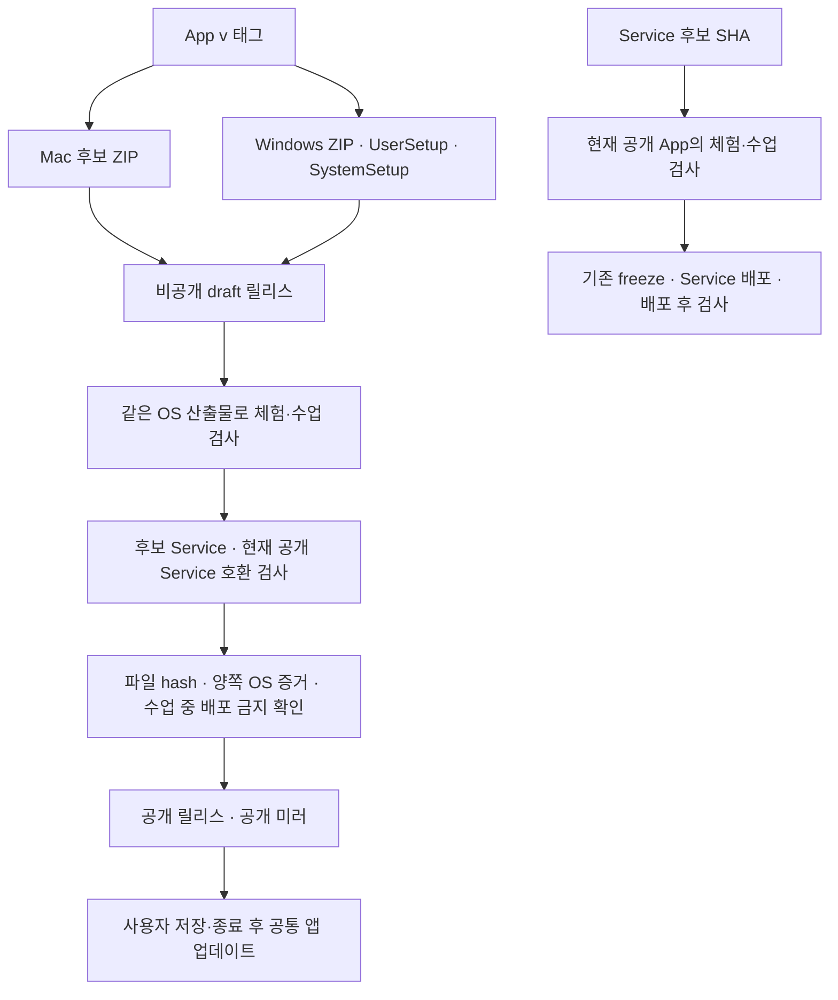

# 공통 Studio 릴리스와 기존 체험 실행기 이행

체험과 수업은 한 App 안의 활동이다. 코드·파일·대화·예산을 합치는 작업이 아니다.
INT-US-02/04, US-07~16의 실행 절차이며 [실행 기록](../testing/unified-completion-917-919-evidence.md)과 함께 읽는다.



## App 후보

`build-mac.yml`, `build-windows.yml`은 패키지를 draft에 올리고
`verify-unified-release.yml`을 명시적으로 dispatch한다. 패키지는 업로드 후 덮어쓰지
않는다. 잘못된 후보는 새 태그로 다시 만든다. 이미 공개된 태그를 draft로 되돌리거나
같은 이름의 설치 파일을 바꾸지 않는다.

검사는 아래를 구분한다.

- `e2e/unified-release/run.mjs`: 수정하지 않은 후보 App과 후보 Studio 커밋의
  `config/service-deployment.json`에 고정된 Service 소스. `HPS_SERVICE_SOURCE`는
  그 SHA의 깨끗한 checkout이어야 하며, 없거나 다르면 실패한다. 과거 testkit의
  Worker 구현으로 대체하지 않는다. App SHA와 Service SHA는 별도 기록한다.
  각 OS에서 체험·수업 각각 A/B 전환, 초안/첨부, 실제 모델 파일 생성, 요청 자료 분리,
  실제 암호화 저장과 프로세스 재시작을 검사한다. Service 바인딩은 합성이며 Cloudflare
  배포 인수는 아니다. 활동별 upstream 요청 최대 8회, 동시 테스트 1개, 실패 시 중단한다.
- `install-windows.mjs`: 폐기 가능한 Windows CI에서 User/System 설치기를 실제로
  별도 위치에 설치하고 모든 portable payload 파일을 대조한다. 로컬 Mac에서는 실행 불가다.
  Windows 빌드는 `scripts/patches/windows-policy-locales.patch`를 fork의 patch
  디렉터리에 복사한 뒤 준비한다. 정책 파일의 언어별 하위 폴더도 설치본에 포함한다.
  patch 적용 검사는 설치본 검증을 대신하지 않는다.
- `public.mjs`: checks the same candidate App against the current public Service with
  synthetic trial and classroom codes minted for this run, and creates two files in each
  activity. Existing policy and request limits apply and a failed activity is not retried
  (only a 403 read in the first 20 s after minting is re-read, for KV convergence). The
  model key is never passed to the App. It touches no real cohort: it opens and closes one
  short session on the synthetic acceptance cohort only ([credentials](#public-acceptance-credentials-1404)).
- `check-unified-release.mjs`: 양쪽 OS receipt와 현재 다운로드 bytes를 대조한다.
  실호출 없는 검사, 공개 연결 누락, 실패/skip/옛 SHA/다른 artifact는 승격하지 않는다.
  최종 freeze 후 공개하며, mirror의 수동 dispatch도 같은 판정기를 거친다.

### Public acceptance credentials (#1404)

Static codes did not survive a second release. A trial code's one-hour window and
40-request allowance start on first use and a reissue to the same handle does not reset
them; a classroom code needs an open session, and an open session read as a live class
blocked the same run's `publish` job and every worker deploy. Acceptance therefore mints
its own credentials on every run, on a cohort that cannot hold a real participant.

- **CI settings**: `HPS_ACCEPTANCE_ANTHROPIC_API_KEY`, plus either `HPS_ACCEPTANCE_ISSUER`
  (preferred) or `HPS_ADMIN_PASSWORD`. The latter is the secret the `publish` job's freeze
  already uses, so the fallback needs no new long-lived secret.
- **Cohort**: `synthetic-release-acceptance`
  (`worker/src/profiles/synthetic-release-acceptance.ts`). It is `studio-native-trial`
  under another identity; `worker/test/profile-serving-snapshot.test.mjs` asserts both are
  served identically, so a pass here is evidence about trial seats. It declares
  `synthetic: true`: every roster write and token mint on it must name a `synthetic-`
  handle (otherwise `400 synthetic_handle_required`), and it is hidden from the console.
- **Per run and OS**: a fresh handle `synthetic-acceptance-<platform>-<time>-<random>`;
  `POST /admin/cohorts/synthetic-release-acceptance/session/open` (1 h, `force`) returns the
  classroom code; `POST /admin/tokens/issue` with `native_trial` returns the trial code
  with a fresh allowance. `finally` revokes the trial grant and closes the session, which
  revokes the classroom code. A cleanup failure is logged, not turned into a failure.
- **Freeze**: `GET /admin/cohorts` reports `synthetic` per cohort from the compiled
  profiles. `scripts/check-live-sessions.mjs` ignores a live session only when its cohort
  is reported exactly `synthetic: true` and the session runs one of that cohort's own
  profiles, and names what it ignored. Anything else, including the field missing from an
  older worker, still blocks. A session left behind by a killed run therefore blocks
  neither this run's `publish` job nor a worker deploy.
- **Scoped issuer**: mint with `worker/scripts/issue-issuer-token.ts --cohorts
  synthetic-release-acceptance --profiles synthetic-release-acceptance --max-hours 1
  --can-start-session --max-session-hours 1`. The trial mint requires the issuer itself to
  stay valid for at least an hour after each run starts.
- **Order**: deploy the worker that carries this cohort first. Against an older Service the
  mint is refused, acceptance reports BLOCKED, and the App candidate stays draft.
- **Fallback**: with neither credential set, `HPS_ACCEPTANCE_TRIAL_CODE` and
  `HPS_ACCEPTANCE_CLASSROOM_CODE` are read as before (single-use per release; the
  classroom code needs a session opened by hand). The receipt records which path ran as
  `publicService.credentials`.
- **Limits**: the cohort has one session key, so the two OS runs stay sequential
  (`max-parallel: 1`). Two different tags accepting at the same moment can close each
  other's session; rerun the failed leg. The roster grows by one synthetic handle per OS
  run. No real participant, price or payment change, or limit relaxation is involved.

원문 입력/응답/도구·화면은 합성 자료로 한정한다. 토큰은 evidence 밖 임시 파일에 두고
마지막에 삭제한다. trace/video는 끄며 자격 입력 화면을 촬영하지 않는다.
필수 모델 설정을 App 번들 또는 공개 receipt에 넣지 않는다.

## Service와 Module

Since 2026-10-19 Studio does not deploy the Service Worker. hypeproof-service owns
the deploy (`npm run release:deploy`, its `worker/DEPLOY.md`), and hypeproof-ops
`opsdb.py` applies schema migrations. `deploy-worker.yml` is verification only: it
runs the Service tests at the `config/service-deployment.json` pin, optionally runs
`verify-service-activities.yml` (the public App's two activities against that
Service SHA) and optionally the production verification scripts. It holds no
Cloudflare credential. `config/service-deployment.json` is retired as a deploy pin;
it remains the Service SHA that Studio's compatibility and e2e workflows test.
Service 변경만으로 App 전체 빌드를 실행하지 않는다.

현재 Module pin은 변경하지 않는다. Module 발행/복귀는 기존 불변 버전과 대상 강의
검사를 따라야 하며 이 App 게이트가 Module 전체 인수를 대신하지 않는다.
새 App에는 `/v1/activity`가 필요하므로 Service 호환 버전 반영 후 App을 공개한다.
공개 Service 검사가 구버전 API를 만나면 App 후보는 draft에 남는다.

## 기존 실행기

검증된 공통 앱을 설치하고 기존 작업을 저장·종료한 뒤 실행한다. 현재 실행 중인 앱을
강제 종료하거나 운영 앱에 개발 확장을 주입하지 않는다. 설치는 기존
`scripts/install-mac.sh`의 백업·실행 중 앱 검사 절차를 따른다.

```bash
# 실제 .command 파일 경로를 사용한다. Desktop symlink 자체는 수정하지 않는다.
node scripts/unified-launcher.mjs '/절대/경로/시작.command'
node scripts/unified-launcher.mjs '/절대/경로/시작.command' --apply
# 출력된 백업 경로로 되돌리기
node scripts/unified-launcher.mjs --restore '/출력된/백업/경로'
```

처음 명령은 계획만 표시한다. 호환되지 않는 앱이면 실행기 교체를 거부한다.
적용은 공통 `/Applications/HypeProof Studio.app`을 여는 명령으로만 바꾸고 기존
실행기 bytes·권한을 비공개 백업한다. 앱 호환 마커 검사는 최종 artifact 검증을 대신하지
않는다. 기존 user-data/작업 파일/credential은 복사·삭제하지 않는다. 공개 코드는 새
앱에서 다시 확인한다. 기존 대화는 원래 데이터에 남으며 시작 화면의 별도 내보내기는
자동 공유나 새 활동의 모델 문맥 이행을 하지 않는다.

이행 실패 시 출력된 백업으로 실행기만 복원한다. 사용자 수정이 생겼다면 덮어쓰기를
거부한다. App 복귀는 이전 검증된 설치본, Service 복귀는 이전 Worker revision,
Module 복귀는 이전 pin을 사용한다. DB를 되감아 복구를 연습하지 않는다.
사용자가 새 앱을 실제 재시작하기 전에는 ‘업데이트 제공’으로만 기록한다.

### Service compatibility diagnostics (#1651)

The Service-only compatibility workflow and deployment read the same immutable
`config/service-deployment.json` pin. The runner refuses a dirty checkout or a
mismatched commit, runs that checkout's gateway, and records its commit and source
hash before launching the unchanged public App. Installed testkit provenance is
retained for App-release runs; it cannot substitute for the deployment candidate.

The public App performs auxiliary title requests as well as file tools. The failed
2026-10-15 run spent calls 1 and 5 on titles, calls 2–4 on the initial write/read/final
answer, and calls 6–8 on the revision before the requested reread completed. The
Service-only synthetic acceptance now has an explicit total cap of **12 upstream
attempts per activity**, including titles and retries. Attempt 13 must be recorded
and rejected before provider dispatch. This changes only the rehearsal cap; no
production grant, participant quota, or completion assertion changes. Both completed
turns, correct file contents, the unchanged original, and zero recorded gateway
failures are required. HTTP 200 alone is insufficient.

Failure evidence preserves the stage, synthetic work files and post-entry transcript,
plus a sanitized gateway log before temporary credentials are deleted. Credential
entry is never captured. These artifacts diagnose failures; they do not create a
passing receipt. `workflow_dispatch` can run compatibility without deploying anything.
