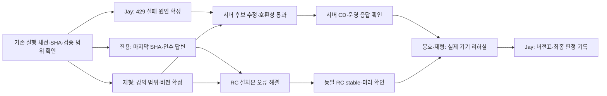

# 10/17 강의 준비 — 10/16 긴급 실행 계획

작성: 2026-10-16 · 실행 담당: Jay · 근거: 당일 15:40~15:50 확인 자료

## 목표와 완료 조건

오늘 사용할 서버·앱·SDK·프로필 버전을 고정하고, 서버 CD와 앱 릴리스를 각각 검증한 뒤 실제 강의 기기에서 리허설을 끝낸다. main은 그대로 유지한다.

완료는 다음 네 가지 증거가 모두 있을 때 판정한다.

- 서버: 선택한 Service SHA 배포 성공 + 운영 health + 실제 모델 응답 확인.
- 앱: 선택한 RC의 Mac·Windows 설치본 검증 성공 + 동일 커밋 stable 릴리스/미러 확인.
- 버전: 앱 태그·SHA·설치 파일 해시·SDK·Service SHA·프로필이 하나의 버전표에 기록됨.
- 수업: 실제 기기 설치→입장→사진 수정→저장·재열기→게시 전체 리허설 통과, 최종 판정 담당 명시.

CI 성공, 빌드 성공, dry-run 성공만으로 출하 또는 강의 준비 완료로 표시하지 않는다.

## 이미 완료한 준비

- [x] #team에 업데이트한 담당·의존 관계 그래프와 인수 요청 게시.
- [x] 진용·봉호 멘션. 제형은 실명 요청 및 전달 요청. 담당 수락은 아직 미확인.
- [x] Service 후보별 변경 비교와 운영/후보를 구분한 버전표 초안 작성.
- [x] 최신 CD 실행 `38858910381` 양 OS 실패 자료 확보 및 429 오류 확인.
- [x] 앱 RC 검증 실패와 서버 CD 실패를 별도 작업으로 분리.

## P0 — 지금 이 세션에서 먼저 할 일

### 0. 다른 실행 세션과 범위 확인 — 모든 수정·재실행보다 먼저

2026-10-16 18:46 KST 조회 기준, 이 긴급 plan 전체를 실행하는 별도 세션은 확인되지 않았다. 다만 아래 세션이 active/inProgress이며 배포·호환성 검사 작업이 겹친다. 이는 조회 시점의 상태이므로 착수 전에 다시 확인한다.

| 항목 | 확인한 내용 |
|---|---|
| 세션 | 「플랜 구현 진행」 |
| 세션 ID | `01a141f9-2dbd-7c81-ae43-25098b4319b0` |
| 기존 실행 계획 | `docs/plan/studio-feedback-owner-console-implementation-2026-10-16.md` |
| 최근 보고 | 가격 반영 배포의 Mac·Windows 호환성 검사 실행 중. 화면 검증 도구 전체 실행 결과를 독립 검토하고, 이후 PR·원격 검사 진행 예정 |
| 이 긴급 plan과의 관계 | 파일명은 해당 세션의 `git status` 출력에만 등장. 이 plan을 읽거나 실행 지시를 받은 근거는 확인되지 않음 |
| 아직 미확인 | 현재 작업 SHA, worktree, PR, Actions 실행 ID, 검사 대상 Service·앱 버전, 완료 결과 |

- [ ] `mcp__codex_tui__list_threads`와 `read_thread`로 위 세션의 최신 진행 상태·결과를 확인한다. 세션 제목이나 active 표시만으로 작업 완료를 판단하지 않는다.
- [ ] 기존 세션의 worktree·브랜치·SHA·PR·Actions 실행 ID·검증 범위를 기록하고, 이 계획의 후보와 대조한다.
- [ ] 동일 SHA·동일 검증 범위의 실행이 진행 중이면 중복 dispatch하지 않고 결과를 확인한다. 후보 또는 검증 범위가 다르면 별도 검사가 필요한 이유를 기록한다.
- [ ] 다른 세션이 수정 중인 파일·브랜치를 덮어쓰거나 실행을 취소하지 않는다. 겹치는 구현은 인계 범위를 확인한 뒤 진행한다.
- [ ] 확인 대기 중에는 기존 로그 분석, 후보 비교, 버전표 정리 등 충돌 없는 읽기 작업을 계속한다.
- [ ] 기존 세션 결과를 재사용할 때는 정확한 SHA·환경·실행 링크를 붙인다. 가격/화면 검증의 성공을 앱 릴리스·강의 리허설 성공으로 확대 해석하지 않는다.
- [ ] 이 긴급 plan의 실행 담당 세션 ID와 인수 범위를 아래에 기록한다.

긴급 plan 실행 담당 세션: **미지정** · 기존 세션에서 인수할 작업: **미확정**

### 1. 서버 CD의 429 실패 원인 확정 — Jay

- [ ] 기존 작업 세션·worktree·dirty 상태와 최신 관련 PR을 먼저 확인해 중복 수정 방지.
- [ ] 실행 `38858910381`의 요청 ledger, gateway 로그, 실패 transcript를 시간순으로 맞춘다.
- [ ] 요청 시작 → upstream 취소/연결 종료 → 실행 중 점유 해제 → 재요청 경로를 추적한다.
- [ ] 사용자·세션 식별자 충돌, 잔여 점유, 취소 후 cleanup 누락, fixture 문제를 증거로 구분한다.
- [ ] 원인과 수정 위치를 확정한 뒤 별도 작업 브랜치에서 최소 수정 및 회귀 검증을 준비한다. 다른 작업자의 브랜치를 덮어쓰지 않는다.
- [ ] 같은 후보에서 Mac·Windows 호환성 검사를 다시 통과시키고 결과를 기록한다.

현재 증거: Service `bbb5aad14bbe2b655a34cdcd59b09a268ea863b0`에서도 양 OS가 `handover-v1.md` 생성 240초 대기 후 실패. 화면에 API 429 “이미 실행 중인 요청”, output guard에 `AbortError`. 취소와 점유 미해제의 인과관계는 아직 미확정이다. 타임아웃 증가나 게이트 건너뛰기로 해결 처리하지 않는다.

### 2. 앱 RC 실패를 독립적으로 진단 — Jay 준비, 진용 담당 확답 대기

- [ ] 실행 `38784437508`의 Mac·Windows 로그와 설치본 정보를 확보한다.
- [ ] Mac의 `Visible start surface was not found`가 시작 실패인지 화면 탐색 조건 문제인지 구분한다.
- [ ] Windows의 `policies/en-us/HypeProofStudio.adml` ENOENT가 패키징 누락인지 압축 해제/경로 문제인지 구분한다.
- [ ] 진용의 미푸시 작업·현재 SHA를 확인한 뒤 구현 범위를 나눈다. 미확인 상태에서는 독립 진단까지만 진행한다.
- [ ] 수정 후보의 실제 설치본으로 두 OS 검증을 통과시킨다.

### 3. 출하 버전표와 롤백 기준 확정 준비 — Jay

- [ ] 최신 원격 상태를 다시 읽고 후보를 움직이는 main 대신 정확한 SHA로 기록한다.
- [ ] 앱 태그/SHA, SDK 버전, Service SHA, 프로필, 설치 파일 SHA-256, CD 실행 링크를 채운다.
- [ ] 운영의 마지막 정상 서버 버전과 앱 설치본을 확인한다. 이전 앱의 현재 서버 호환성도 별도 확인한다.
- [ ] 10/17 20:00 회수 예약이 실제 등록됐는지 확인한다. 토큰 값은 출력하거나 팀 채널에 올리지 않는다.

## P0 — 빠른 답변이 필요한 요청

| 대상 | 먼저 받아야 할 답 | 답변 후 할 일 | 미응답/담당 불가 시 |
|---|---|---|---|
| 진용 | 오늘 릴리스까지 맡을 수 있는지, 마지막 SHA·미푸시 작업·막힌 점·ETA | #1684와 현재 RC의 적용 관계를 확인하고 릴리스 경로 확정 | Jay가 인수하되 원격 브랜치/진행 작업 확인 후 별도 브랜치로 이어감 |
| 제형 | App·SDK·Service 후보, #109/#1717 계속 담당 여부, Cloudflare 자동/수동 범위 | 최소 후보와 필요한 수정 포함 후보 중 하나를 선택 | Jay가 후보 차이를 제시하고 인수 범위 기록. 응답 부재를 후보 승인으로 간주하지 않음 |
| 봉호 | 실제 리허설 가능 시간, Windows 기기 담당, 아직 미확인인 단계 | 실제 기기 전체 흐름 확인 | Jay가 테스트 가능한 기기를 확인하고 미확인 기기는 NOT RUN으로 유지 |
| Jay | 오늘 최종 출하/강의 준비 판정 담당 확정 | 실패·미실행 목록을 보고 최종 판단 | 담당 공백을 문서상 임의 수락으로 바꾸지 않음 |

후보 비교: 운영에 매핑된 Service `9dbe15c8` 기준 Cloudflare 후보 `684af11d`는 1커밋·2파일, `d2d48f2`는 4커밋·50파일. `bbb5aad1`은 `d2d48f2` 이후 3커밋·10파일이며 최신 호환성 검사에서도 실패했다. 서로 대체 가능한 후보로 간주하지 않는다.

## P1 — 실패 해결 및 후보 확정 후 실행

### 4. 서버 CD 완료 — 제형 또는 인수한 Jay

- [ ] 선택한 Service SHA와 Studio 배포 설정이 일치하는지 확인.
- [ ] dry-run 계획·호환성 검사·수업 세션 상태 확인.
- [ ] 게이트 통과 후 CD 실행, 운영 SHA·프로필·health·실제 응답 관측.
- [ ] 실패 시 이전 정상 배포로 복구할 경로와 담당 기록.

### 5. 앱 릴리스 완료 — 진용 또는 인수한 Jay

- [ ] 태그 원본은 `hypeproof/hypeproof-studio`임을 확인. `hypeproof-studio-releases`는 미러.
- [ ] `release-cut.yml`에 정확한 후보 SHA를 지정하고 먼저 dry-run 결과 확인.
- [ ] #1684의 실제 포함 여부와 publish gate 실행 증거 확인. 당시 OPEN/CI 12개 성공은 배포 게이트 실동작 증거가 아님.
- [ ] RC 생성/검증 후 승인된 동일 RC 커밋을 stable로 출하. 미러와 설치 파일 해시 확인.
- [ ] 자동 관리되는 `release/<version>` 브랜치에 임의 구현을 추가하지 않는다.
- [ ] release PR 병합으로 main이 바뀌는 절차는 이번 main 유지 조건과 분리한다. 절차 충돌 시 임의 우회하지 않고 출하 경로를 재확정한다.

### 6. 실제 수업 리허설 — 봉호·제형, Jay 기록

- [ ] 실제 Mac/Windows 설치 및 첫 실행.
- [ ] 강사 세션 생성·참가 코드·학생 입장.
- [ ] 실제 모델 응답과 중단 후 재시도.
- [ ] 사진 수정, 파일 저장·재열기, 게시 URL 외부 접근.
- [ ] 강사 대본과 최종 서버/앱 버전 일치 확인.
- [ ] 수업 종료·권한 회수 경로 확인. 예약 등록과 실제 회수 성공은 따로 기록.
- [ ] 최종 판정: PASS / FAIL / BLOCKED / NOT RUN 및 담당·기기·시각·증거 링크.

## 작업 순서

## 근거와 산출물

- [팀 요청 채널](https://discord.com/channels/1457738053895328004/1457738054348574761)
- [최신 서버 CD 실패](https://github.com/hypeproof/hypeproof-studio/actions/runs/38858910381)
- [RC 검증 실패](https://github.com/hypeproof/hypeproof-studio/actions/runs/38784437508)
- [진용 릴리스 게이트 #1684](https://github.com/hypeproof/hypeproof-studio/pull/1684)
- [Service 후보 #109](https://github.com/hypeproof/hypeproof-service/pull/109), [Studio 배포 후보 #1717](https://github.com/hypeproof/hypeproof-studio/pull/1717)
- 준비 자료: `/Users/jaylee/CodeWorkspace/artifacts/lecture-server-todo-20261016/jay-preflight/`
- 전체 HTML: `/Users/jaylee/CodeWorkspace/artifacts/lecture-server-todo-20261016/index.html`

이 문서는 실행 계획이다. 체크되지 않은 항목은 실행/검증 완료를 의미하지 않는다. 이후 상태가 바뀌면 동일 후보 SHA와 실제 증거를 기준으로 갱신한다.

## 실행 갱신 — 2026-10-16 19:45 KST 이후

이 절이 위의 이전 스냅샷보다 우선한다. 코드 수정과 출하 완료를 구분한다.
실행 세션: `01a1443c-5fac-7951-935b-cd73cf01f166`.
사용자는 진용 미응답 이후 **릴리스 실패 수정 인수**를 지시했다. 담당 미응답으로 코드 작업을 더 기다리지 않는다.

### P0-0 완료: 충돌 범위와 main 보존

- 기존 세션 `01a141f9-2dbd-7c81-ae43-25098b4319b0`은 `active/inProgress`다. 최신 작업은 Owner 원가 반영·실화면 확인과 #1731 native/render 실패 수정이다.
- 작성 중인 worktree: `../.codex-worktrees/feedback-render-revisions-1730-20261016`, 브랜치 `fix/issue-1730-render-revision-evidence`, SHA `a9d650cee9c197f21e123b747c5ce7373c27a1b3`, [PR #1731](https://github.com/hypeproof/hypeproof-studio/pull/1731), [Actions 38883148818](https://github.com/hypeproof/hypeproof-studio/actions/runs/38883148818). `startPage.ts`, `chatPanelProvider.ts`, focus diagnostics, native runner 등에 미커밋 변경이 있다. 해당 파일·worktree는 수정하지 않았다.
- 기존 세션의 서버 #119 수정도 재구현하지 않았다. Actions 진행 상태를 재조회하고 동일 SHA/범위의 재dispatch·취소를 하지 않았다.
- 진용 PR: [#1684](https://github.com/hypeproof/hypeproof-studio/pull/1684), `feat/issue-1683-publish-gate`, `2442efea7095f774a1365862e105df3c35a652fa`, OPEN. stable 승인 게이트이며 이번 오류 수정은 포함하지 않는다. 미푸시 원격 기기 작업은 조회할 수 없다. 이 PR의 승인 정책을 바꾸거나 대신 병합하지 않았다.
- 공유 checkout은 `chore/work-ready-20260913` / `b70a54833cd0b6cb89ba6b8aa68067ec63ea2072` 그대로다. 기존 tracked/untracked 변경과 submodule 변경을 보존했다.
- 로컬 main 전용 경로 `../hypeproof-studio-main`을 만들고 **fast-forward만** 수행했다. `main == origin/main == 8021d592c0821f4514144bcbfb8335092dc0396b`. 원격 main 쓰기·병합 없음. 공유 checkout을 main으로 전환하면 다른 세션에 영향이 있어 전환하지 않았다.
- 우리 작업: `../.codex-worktrees/lecture-p0-20261016`, `fix/lecture-p0-evidence-20261016`. Service 회귀검사는 별도 detached worktree `../.codex-worktrees/lecture-p0-service-133baa`에서 수행했다.

### 서버 배포 확인: 완료, 강의 전체 수용은 미완료

| 대상 | 정확한 관측 |
|---|---|
| 제형 실행 | [38873431395](https://github.com/hypeproof/hypeproof-studio/actions/runs/38873431395), actor `JeHyeong2`, SUCCESS |
| 후속 실행 | [38882511112](https://github.com/hypeproof/hypeproof-studio/actions/runs/38882511112), actor `jayleekr`, SUCCESS |
| Studio 배포 드라이버 | `447f49b7bcec01d515a39b5e36bdc37f2a96fd40` |
| 실제 Service pin | `133baa506fae340743a4562d2afbf443d132d503` |
| 실제 override | 두 실행 모두 `dry_run=false`, `override_live_session=true`, `skip_activity_compatibility=false`. 활성 세션 2건에 대해 freeze override가 기록됐다. 테스트 생략으로 성공한 실행이 아니다. |
| 현재 운영 | Cloudflare version `9a0ed9c6-e397-4af5-8333-4a303717506e`, deployment `abf1456f-6d0c-412d-a034-be3cec0765d1`, traffic 100%. API metadata와 `/v1/health` 직접 조회 일치, `w0.0.0-dev+447f49b7`. |
| 운영 모델 증거 | 후속 CD의 canary SDK contract 6/6 PASS, canary 종료·회수 기록. 일반 verify-prod L3는 TOKEN 미지정으로 SKIP. 10/17 강의 프로필 전체 리허설 증거는 아니다. |

### P0-1 완료: 429 원인과 기존 수정 검증

실패 [38858910381](https://github.com/hypeproof/hypeproof-studio/actions/runs/38858910381)의 Service는 `bbb5aad14bbe2b655a34cdcd59b09a268ea863b0`이다.

| OS | 원본 inbound ledger 순서 |
|---|---|
| Mac | request 9 시작 `06:02:54.348Z`; request 10 시작 `.370Z`, 429 완료 `.372Z`; request 9 disconnect `.517Z` |
| Windows | request 9 시작 `06:04:42.848Z`; request 10 시작 `06:04:43.088Z`, 429 완료 `.092Z`; request 9 disconnect `.469Z` |

두 OS 모두 **429가 취소보다 먼저**다. 제목 생성 요청과 사용자 요청이 같은 native grant를 겹쳐 사용했고, 뒤 요청이 busy로 거절된 뒤 SDK가 첫 스트림을 취소했다. 이 실패를 취소 후 잔여 lease로 설명할 수 없다. 양 OS는 별도 합성 저장소이므로 OS 간 사용자 ID 충돌도 이 증거의 원인이 아니다.

[Service #119](https://github.com/hypeproof/hypeproof-service/pull/119)의 merge SHA `9cd0d834179c6ca5d8e5b75a121c91972308fa84`가 atomic lease를 유지하면서 겹친 admission을 최대 10초 기다린다. 테스트 timeout 증가가 아니라 서버 admission 동작 수정이며, 취소·권한·만료·quota·중복 검증과 실제 요청별 과금은 유지한다. 현재 `133baa50`에 포함됐다.

- 후속 CD 양 OS receipt PASS. **수정하지 않은 App v0.1.56**, App SHA `f5939d9cf6bbf42588eacd370e2faf9cde7c53bc`, Service `133baa506fae340743a4562d2afbf443d132d503`. payload tree 전후 동일. trial/classroom의 겹친 요청들이 HTTP 200으로 순차 완료됐다.
- 독립 로컬 실행: `node --experimental-strip-types --test worker/test/native-admission-wait.test.mjs`, 현재 배포 Service SHA에서 **16/16 PASS**, 20.09초. synthetic Hono/SQLite·mock upstream 검증이다. 최초 실행은 foundational package 미빌드로 실패했고 정식 `npm run setup:packages -- worker` 후 재실행했다. 최초 실패 로그도 보존했다.
- 새 v2026.1016.0 앱의 릴리스 수용 통과를 의미하지 않는다. 같은 서버 후보/기존 앱의 OS 검사를 중복 실행하지 않았다.

### P0-2 진행: 앱 실패 인수, 수정 완료 / 설치본 검증 미완료

코드 수정 SHA: `ed3e61046d5716ad600b59655042ef6add9e64c5`. 기존 main·submodule pointer·다른 세션 소스는 변경하지 않았다.

1. 이전 Mac [38784437508](https://github.com/hypeproof/hypeproof-studio/actions/runs/38784437508): failure.png에는 activity-b 채팅이 이미 떠 있고 모델 응답 3건도 있다. `native-unified-switch.spec.ts:65`가 자동 복귀 이후 시작 화면을 다시 기다린 오류다. 현재 호스트의 bound activity 자동 복귀와 일치하도록 폴더 전환 및 cold restart에서 채팅을 확인한다. 초안·첨부·암호화·재시작·파일/활동 분리 검사는 유지했다.
2. Windows의 같은 오류는 최신 [38881305084](https://github.com/hypeproof/hypeproof-studio/actions/runs/38881305084)에서도 재현됐다. portable ZIP에 `policies/en-us/HypeProofStudio.adml`이 실제 존재한다. 고정 upstream `560a9dba96f961efea7b1612916f89e5d5d4d679`의 `build/win32/code.iss`는 일반 복사에서 policies를 제외하고 별도 policies 규칙에 `recursesubdirs`를 누락했다. fork 패치도 이를 보완하지 않는다. Studio 소유 patch를 Windows 빌드의 fork patch 단계에 전달해 언어 하위 폴더를 포함했다. payload 비교 gate에서 파일을 제외하지 않았다.
3. 최신 Mac 실패는 첫 모델 요청의 오류 배너다. 그 실행은 Service deployment pin이 아니라 **testkit 0.1.2**, source digest `118dbd762b6a00345a2c95fce068dbdb730341664f53621ffbcd2541fc9e6012`의 과거 Worker를 사용한다. 새 서버 #119가 들어 있는 운영/호환성 검사와 다르다. 앱 수용 검사도 `HPS_SERVICE_SOURCE`의 깨끗한 배포 pin을 필수로 사용하고, 누락·변조 시 실패하도록 연결했다. 과거 testkit으로 fallback하지 않는다. 최신 RC 원본에는 inbound ledger가 없어 정확한 429 타이밍까지 동일했다고 단정하지 않는다.

검증 상태:

- PASS: release/Service provenance/output-bound/installer patch 제어 17개, SDK seed 제어, launcher recovery 제어, 기존 initial-surface host 제어, workflow shell 검사, mirror timeout 검사, docs contract 100/100, `git diff --check`.
- PASS: 실제 고정 upstream installer 소스에 새 patch `git apply --check`. **실제 Windows 설치 성공은 아직 아니다.**
- FAIL/BLOCKED: 다운로드한 미수정 Mac stable 앱을 별도 경로·숨김 창·전용 user-data·합성 Service로 실제 실행했다. `safeStorage.isEncryptionAvailable() == false`에서 중단됐다. 암호화 검사를 생략하거나 개인 keychain 설정을 바꾸지 않았다. 모델 호출 0, classroom 후속 실행 NOT RUN. 따라서 수정한 UI 경로의 native PASS는 아직 없다.
- NOT RUN: 수정 SHA로 새 Mac/Windows 빌드, 양 OS 설치본 수용, public Service 연결, stable 승격. 기존 태그/asset 교체·검증 receipt 위조·게이트 우회 없음.

### P0-3 진행: 실제 버전표와 회수 예약

| 항목 | 확인값 |
|---|---|
| 공개 stable | `v2026.1016.0`, source release ID `414734964`, mirror ID `414811863` |
| stable 내부 App SHA | Mac/Windows ZIP 직접 다운로드·내부 product.json 확인: `447f49b7bcec01d515a39b5e36bdc37f2a96fd40` |
| bundled SDK | 양 OS vendor package.json 직접 확인: `0.3.299` |
| 기존 RC 태그 | `v2026.1016.0-rc.1` → `6ad5f9f895d07af8ab8f6abf7c19e4fdecd53c0e`. stable과 동일 SHA가 아니다. |
| 강의 프로필 | 배포 pin에 포함된 `boah-dental-2026-1017-s1`; 실제 강의 credential의 profile 관측/전체 흐름 NOT RUN |
| Mac ZIP SHA-256 | `3172100aae81b79fcecf0812abdfeda84fb06bf17940c7777516d269dfaba83c` |
| Windows ZIP SHA-256 | `5a10f6aacccc66cbf3dc3679d85a671c4f0aa92d9335fca81986d24079b58bd2` |
| SystemSetup SHA-256 | GitHub asset metadata: `da1b4608284aa0f9b897af94012cba3b08262f5acac68c5779a92e6ef4400f43` |
| UserSetup SHA-256 | GitHub asset metadata: `adcfbb5bf82344fb5d79c6595437307ea33bbb41129c9861787e2626b1b08f6a` |

ZIP 해시는 다운로드 bytes와 GitHub digest를 직접 대조했다. source의 7개 binary asset은 mirror의 이름·크기·digest와 일치한다. 하지만 [mirror 38884441819](https://github.com/hypeproof/hypeproof-studio/actions/runs/38884441819)는 `unified-acceptance.json` 누락으로 FAIL이고 실제 source/mirror에도 이 파일이 없다. 공개·미러 존재를 수용 검사 통과로 기록하지 않는다.

마지막 이전 서버 정상 배포는 [38762752350](https://github.com/hypeproof/hypeproof-studio/actions/runs/38762752350), Studio `6ad5f9f895d07af8ab8f6abf7c19e4fdecd53c0e` / Service `9dbe15c886930e14134e7c42d382bc781e16df46` 기록이다. 이전 App v0.1.56과 현재 서버 후보의 호환성 PASS는 위 receipt로 확보했다. 실제 rollback·이전 앱 강의 재설치는 실행하지 않았다. 현재 두 배포는 같은 Service이므로 직전 Cloudflare version으로 복귀해도 코드상 이전 Service가 되는 것은 아니다.

회수 예약 `com.hypeproof.revoke-issuer-e9ef79af`는 launchd에 실제 로드돼 있고 `Month=10, Day=17, Hour=20, Minute=0`이다. script 존재/hash 확인, `state=not running`, `runs=0`, `last exit=(never exited)`. 예약 등록 PASS, 실제 회수 NOT RUN. 토큰 값·스크립트 본문은 보고서에 넣지 않았다.

### 남은 일과 답변 대기 구분

- **진용 답변 대기는 해제**: 사용자의 인수 지시로 전용 브랜치에서 진행. #1684는 별도 승인 게이트 PR로 보존.
- 계속할 일: 수정 PR의 정확한 SHA CI, 새 RC dry-run, Mac/Windows candidate build와 untouched installer acceptance. 실패하면 동일 원인의 로그를 확인하고 해당 브랜치에서 수정한다.
- 답변 필요: 실제 강의 Mac/Windows 기기 담당·리허설 시간, 최종 출하 판정 담당. 침묵을 리허설 또는 출하 승인으로 간주하지 않는다.
- P1 서버: 현재 배포 확인 완료. 새 중복 배포 불필요. 강의 프로필 실제 응답/중단·재시도는 별도 미실행.
- P1 앱: FAIL / 수정 검증 진행. stable이 이미 공개돼 있어도 RC 수용 통과 및 동일 커밋 승격 조건은 미충족.
- P1 수업: 설치→입장→사진 수정→저장/재열기→게시 전체 리허설 NOT RUN.

원본 로그·Actions artifacts·스크린샷·해시 manifest·실행 결과:
`/Users/jaylee/CodeWorkspace/artifacts/lecture-p0-20261016/`.
`p0-evidence.json`, `release-assets-verification.json`, `revocation-schedule.json`,
`admission-regression-ready.log`, `release-fix-controls.log`, `native-no-provider-results.json`을 구분해 읽는다.
