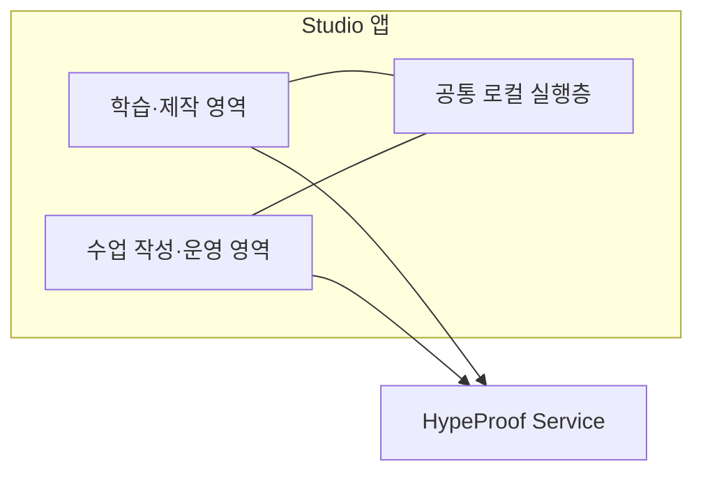

# Studio·Chalk 역할 경계

2026-10-10 · Chalk를 Studio 앱 안으로 통합하는 전제로 수정.
사용자 결정: [AGENTS.md](../../AGENTS.md)의 DEC-012·013.
이 문서는 역할과 작업 범위를 정리한다. 앱 통합 구현은 아직 하지 않았다.
이번 구현 범위는 Worker 의존 제거다. Chalk 웹→App 전환은 backlog다.

## 목표 구조

**실행 환경은 Studio 앱 하나, 제품 책임은 Studio·Chalk 두 영역이다.**

| 영역 | 책임 |
|---|---|
| App 공통 실행층 | 파일·도구·AI 실행·미리보기·인증정보 보관 등 로컬 기반 |
| Studio 작업 영역 | 학습·제작·대화·작업 기록·측정 요청과 결과 표시 |
| Chalk 영역 | 앱 안에서 수업 작성·관리·운영·강사 작업 흐름 제공 |
| HypeProof Service | 서버 권한·공유 상태·저장·측정 엔진·평가 기준 |

Service 소유 공통 패키지는 앱에서도 실행할 수 있다. 공통화는 실제 중복과
공유 계약을 기준으로 하고, CLI 사용 강제를 근거로 삼지 않는다.

## 현재 코드에서 정리할 것

| 현재 코드 | 정리 방향 |
|---|---|
| [chalk/src/ui](../../chalk/src/ui) | 기존 웹 화면을 앱 안의 해당 기능으로 통합한다. |
| [App src/chalk](../../extensions/hypeproof-chat/src/chalk) | 이미 있는 강사 모드·AI 도구·로컬 지도안 작업과 웹의 수업 작성·운영 흐름을 연결한다. |
| [shared.ts](../../chalk/src/shared.ts), [board.ts](../../chalk/src/routes/board.ts), [logs-admin.ts](../../chalk/src/routes/logs-admin.ts) | Worker 소스 의존과 KV·D1·R2 직접 조회는 Service 경계로 정리한다. 서명 비밀과 서버 저장소 접근을 앱에 넣지 않는다. |
| [forward.ts](../../chalk/src/routes/forward.ts)와 화면의 상대 API 요청 | 앱의 Service 연결 방식에 맞춘다. 현재 HTML만 옮겨 놓는 것으로 통합 완료 처리하지 않는다. |
| [chatPanelProvider.ts](../../extensions/hypeproof-chat/src/chatPanelProvider.ts) | 학습·제작 흐름과 Chalk 흐름의 연결을 구분하고 공통 로컬 실행을 재사용한다. |

HTML 지도안과 `hps-session-design/1`은 현재 산출물·API가 다르다.
연결 관계를 확인한 뒤 통합하며, 이름이 비슷하다는 이유로 한쪽을 삭제하지 않는다.
학습자 수업 열람 등 기존 기능도 앱에서 담당 영역을 정해 보존한다.

## 작업 순서

1. **지금:** Studio·Chalk·빌드·테스트에서 기존 `worker/` 의존을 제거한다.
2. **지금:** `worker/` 없는 Studio 체크아웃에서 설치·빌드·테스트를 실제 검증한다.
3. **Backlog:** Chalk 화면의 App 통합과 그 밖의 비Worker 구조 변경.

이번 분리 완료 기준은 Studio에서 `worker/` 폴더를 빼도 빌드·테스트가 돌아가는 것이다.
기존 기능·인증·데이터 동작과 검증 범위를 보존한다.
Chalk의 앱 통합 방식과 운영 웹의 전환 시점은 별도 작업에서 정한다.
