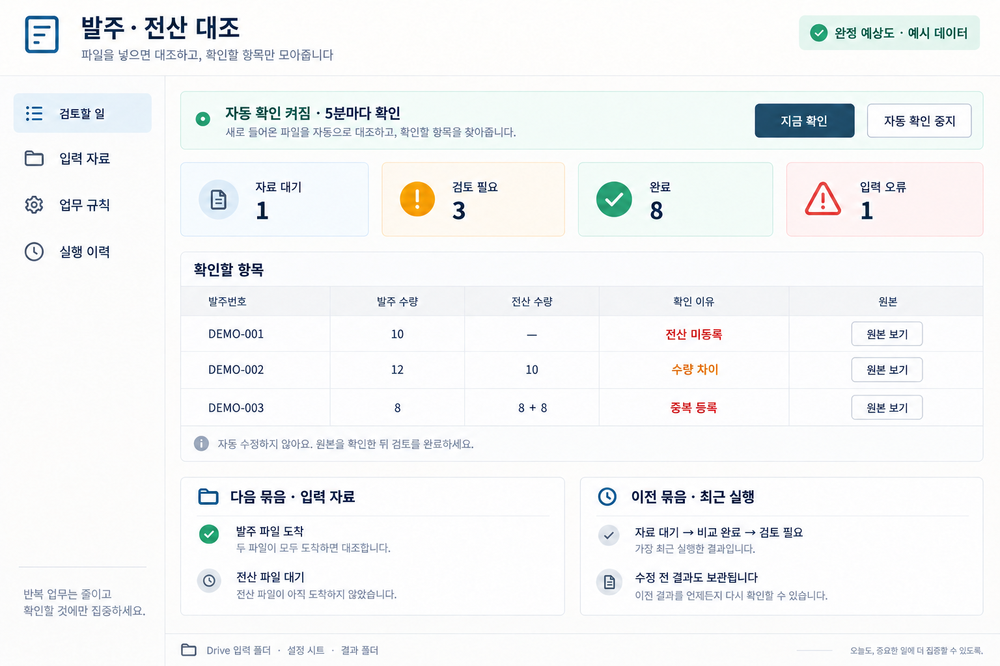
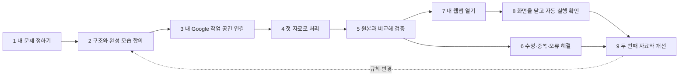

# 내 업무 자동화 도구를 만드는 수강생 경험

2026-10-15 · 설계 v1 · 책임자 TJ · **설계 반영, 확장 기능 구현·배포 전**.

사용자 확정 방향: 문제를 대화로 구체화하고, 두 선택지로 구조를 협의하며,
템플릿 안의 완성 이미지 한 장을 보고, 퀘스트를 따라 구현·검증·개선한다.
가능한 최종 도착점은 **수강생 소유 Google 연동 + Apps Script 웹앱**이다.
아래 4개 템플릿 분류와 구체적인 화면·단계는 이 방향을 실행하기 위한 설계안이다.

## 1. 결과물과 기존 범위의 변경

수강생이 가져가는 것은 **“자료를 넣어두면 정해진 조건에 따라 일하고,
확인할 일만 알려주는 내 업무 자동화 도구”**다. 웹앱은 이 도구의 설정·검토 화면이다.
자료 찾기 → 비교하기 → 회사 양식 맞추기 → 일정 챙기기를 같은 도구 안에서 연결한다.

| 반드시 남는 구성 | 수강생 소유 자산과 역할 | 완료를 확인하는 방법 |
|---|---|---|
| 자료를 넣는 곳 | 내 Drive 입력 폴더, 필요하면 Form과 응답 Sheet | 내 계정으로 접근하고 합성 입력을 넣는다 |
| 업무 규칙 | 설정 Sheet: 입력 종류·식별 기준·주기·마감·보고 양식·제외 조건 | 대화에서 고친 규칙이 저장값 및 다음 실행과 일치한다 |
| 자동 처리 | 내 Apps Script 프로젝트와 내가 설치한 트리거 | Studio와 웹앱을 닫아도 새 실행 이력이 생긴다 |
| 결과 보관 | 내 Drive 결과 폴더의 비교표·보고서·필요 시 PDF | 실제 파일을 열어 원본 위치와 버전을 확인한다 |
| 확인 화면 | 기본은 Apps Script 웹앱, Sheet는 같은 결과를 보는 보조 화면 | 대기·검토 필요·오류·완료와 다음 행동이 일치한다 |
| 처리 기록 | 입력 참조·내용 해시·규칙 버전·실행 주체·시각·결과·오류 이력 | 처음/수정/실패/복구 실행을 구분하고 이전 결과를 찾는다 |

기존 [EA-01–11](email-automation.md)은 공유 실행기를 이용한 검토 후 이메일 발송의
구현 기준으로 보존한다. 이 문서는 이메일을 C10이라는 한 사례로 포함하는 상위 경험이다.
DEC-023의 **개인 Apps Script와 예약 처리 보류는 이 새 설계의 최종 목표에는 적용하지 않는다.**
기존 이메일 실행기를 즉시 바꾸거나 이미 승인한 권한을 확장했다는 뜻은 아니다.
예약 처리는 자료 확인·대조·초안 작성까지이며, 고객 메일은 정확한 대상·본문 승인 후에만 보낸다.

[Product Intent](../PRODUCT-INTENT.md)의 useful work first, human judgment stays visible,
minimum necessary intervention, evidence over claims를 적용한다. 학습 가설은
“자기 문제·규칙을 선택하고 두 번째 자료로 검증하면 실제 반복 사용에 도움이 된다”이다.
가설을 학습 효과나 시간 절감 실적으로 표현하지 않는다. 작업 화면에는 역량 점수·평가 문구를 넣지 않는다.

## 2. 실제 강의 근거와 해석 범위

출처 폴더: 사용자가 제공한 `personal/업무자동화_강의_재설계_20261015/`.
원문·연락처·비공개 Google 링크는 이 저장소에 복제하지 않는다.

| 근거 | 확인한 내용 | 설계에 반영한 것 |
|---|---|---|
| S1 `업무자동화_강의_재설계.md` | PRE-03/10–12 사양, PRE-06/17 감사·정확도, PAD-85/87–89 납기·발주 대조·증빙; 직군보다 실제 작업이 다름 | 문제부터 시작, 숫자 규칙·원본 위치·예외를 먼저 합의 |
| S2 `evidence/seokyung-needs-masked.md` | 채널 CSV 통합, 시청률과 편성 대조, A/S·현장 지원; 메일은 갔지만 시청률을 임의로 만든 실패 후기 | C06–08; 메일 발송 성공과 업무 해결을 분리, 원본 없는 결과 생성 금지 |
| S3 `강의안_v1/페르소나_검토.md` | 초보는 코딩 부담·용어·기록량에 막힘, 숙련자는 자기 업무 연결 필요. 가상 페르소나 검토임 | 한 번에 한 질문, 검증 템플릿, 5분 복구, 선택 확장, 다음 입력 재실행 |
| S4 `강의안_v1/2시간_실습안.md` v1.5 | 입력 대기·중복·충돌·수정·실제 예약 실행에 대한 강사 사본 기록, 새 사본 등은 별도 QA | 입력 묶음별 상태, 현재 결과와 과거 결과 분리, 시작/중지 확인 |
| S5 `실행도구/drive-automation/README.md` | 개인 바인딩 Sheet 기반 대조, 자동 폴더 생성, 상태 변화 이력, 수기 검토메모 | 복사·초기 설정 진입점 재사용 후보. 웹앱과 검토 상태 자동화는 새 설계 |
| S6 사용자 최신 메시지와 전달한 커리큘럼 응답 | 5단계 경험, 10가지 사례, 6개 구성, 120분의 20/35/25/25/15분 배분 | 이 설계의 요구 범위 및 시간 배분 |

S4와 S5의 검증 상태 문구는 열람 시 서로 달랐다. 다른 세션에서 갱신 중이므로
S4의 강사 사본 기록을 Studio 통합 수용 결과로 전환하지 않는다. S1의 일부 문제 정의는
AI가 정리한 게시물일 수 있으며, S3는 실제 인터뷰가 아니다. 아래 10개는 사용자 요청의
실습 적용안이고, 모두를 독립적인 수강생 직접 발언으로 주장하지 않는다.

## 3. 다섯 단계의 대화와 화면

### ① 문제 나열 → 이번에 해결할 문제 정의

시작 문구: **“반복해서 하는 일, 자주 놓치는 일, 시간이 오래 걸리는 일을 편하게 적어 주세요.”**
템플릿이나 도구 이름을 먼저 고르게 하지 않는다. 여러 문제를 받으면 원문을 보존한 문제 카드로
정리한다. 각 카드는 현재 행동, 불편, 반복 주기, 입력 자료, 원하는 결과, 아직 모르는 점을 갖는다.
확인되지 않은 값은 `미정`이다. 다른 문제는 “다음에 할 일”에 남겨 삭제하지 않는다.

예: “발주 누락을 찾고 납기도 챙기고 월말 보고도 해야 해요.”
→ 코치: “발주 대조 결과를 납기와 보고에 재사용할 수 있어요. 오늘 먼저 끝낼 일은 어느 쪽인가요?”
→ **A 발주 누락 찾기 / B 오늘 납기 챙기기**. 월말 보고 카드는 보존한다.

선택한 문제에서 이미 답한 내용은 다시 묻지 않는다. 다음 질문은 현재 가장 큰 불확실성 하나다.
예: “두 파일에서 같은 주문을 찾을 때 어떤 번호를 보나요?”
숫자·자료·업무 설명은 자유 입력으로 받고, 정답을 억지로 두 가지에 맞추지 않는다.
관련 자료 연결은 전용 비공개 입력·선택기에서 한다.

완성되는 **내 업무 한 줄**:
“같은 날짜·회차의 발주와 전산 파일이 모이면 발주번호로 비교해 누락·중복·수량 차이를
원본 행과 함께 보여준다. 자동으로 전산을 고치지는 않는다.”
함께 저장할 값은 `누가 / 언제 / 입력 / 같은 건의 기준 / 출력 / 성공 예 / 예외 / 자동으로 하지 않을 일`.
명확한 요청은 바로 이 요약으로 넘어간다. 확인 버튼이나 명시적인 대화 수락을 저장하고,
무응답·추천 표시를 합의로 취급하지 않는다.

### ② 구조 선제 제안 → 두 선택지로 협의

코치는 확인한 문제에 맞는 템플릿을 추천하고 이유 한 줄과 전체 흐름을 먼저 보여준다.
“두 자료를 비교하는 틀이 맞아요. 내 Drive → 자료 확인 → 대조 → 결과 저장 → 검토 화면으로 만들겠습니다.”
비교를 마치기 전에 라이브러리·API·코드부터 설명하지 않는다.

매 결정 카드에는 **선택지 두 개**, 추천 이유, 비용·권한·결과의 차이, 바꾸면 달라지는 부분을 표시한다.
하단에는 자유로운 수정 요청과 나중에 정하기를 허용한다. 이것은 세 번째 추천안이 아니다.
이미 정한 조건은 질문을 생략한다. 한 번에 하나의 결정만 묻고 선택은 언제든 되돌릴 수 있다.

| 결정 시점 | A | B | 선택 결과 |
|---|---|---|---|
| 비교 대상 식별 | 주문번호 하나 | 주문번호 + 품목번호 | 복합 품목 업무에 A를 자동 적용하지 않음; 키·테스트 변경 |
| 비용과 해석 기능 | **추가 AI 호출 없는 기본형**: CSV/Sheet, 코드 대조 | **AI/OCR 보조형**: 문서·사진 추출, 요약 | A를 기본 추천. B는 전송 자료·예상 사용량·상한을 먼저 보여줌 |
| 자료를 넣는 방법 | 기존 파일을 Drive에 넣기 | Form으로 새 기록 받기 | 입력 어댑터만 변경, 결과·이력 구조 공유 |
| 자료 확인 주기 | 15분마다, 확인 횟수 적음 | 5분마다, 더 자주 확인 | 정확한 실행 시각 보장 문구 금지; 실습 중에는 지금 확인 |
| 결과 정리 | 확인할 항목 표 | 표 + 회사 양식 보고서 초안 | Docs/PDF 생성과 회사 양식 슬롯 추가 |
| 실행 종료 때 | 자동 확인 중지 | 내 계정에서 계속 실행 | 기본 중지; 계속하기 선택과 실제 트리거 상태 저장 |

이 카드들을 모든 사람에게 순서대로 다 묻지는 않는다. 선택 근거가 필요한 것만 노출한다.
“무료”라고 줄여 쓸 때도 **추가 AI 호출 비용 없음·Google 계정 할당량 내**라는 설명을 붙인다.
Studio 이용권, Google 저장공간/조직 계약, AI 처리 비용은 별도다. 유료 선택을 해야
완성할 수 있게 만들지 않으며, 두 경로 모두 가능한 한 개인 Google 웹앱으로 끝난다.
PDF/OCR 자동 추출이 필요 없으면 비용 질문 자체를 생략한다.

### ③ 템플릿 안에서 완성 모습 한 장 확인

대화 옆 기존 미리보기 영역에 **“완성되면 이런 도구를 갖게 돼요”** 카드 하나를 띄운다.
이미지는 선택한 템플릿·업무명·합의 규칙에 맞는 완성 웹앱 모습이다. 기능별 스크린샷 여러 장,
인포그래픽, 코드를 대신 보여주는 구성이 아니다. 합성 데이터를 사용하고 `완성 예상도 · 예시 데이터`를 명시한다.

위 한 장은 이번 설계 검토용 대표 자산이다. 선택된 템플릿의 실제 배포 화면은 아직 아니다.
카드 아래 실제 HTML 텍스트로 핵심 기능·상태 의미·이미지 대체 설명을 제공하고,
**A 이 구조로 만들기 / B 바꿀 부분 말하기**로 이어간다.

| 이미지 계약 | 구체적인 내용 |
|---|---|
| 공통 구성 | 업무명, 상태 요약, 주요 결과 표/카드, 원본 보기, 지금 확인, 자동 확인 중지, 최근 실행 |
| 템플릿별 중심 | T1 차이·원본 표 / T2 제출 현황·보고서 / T3 오늘·임박·지연 / T4 접수·검토·후속 조치 |
| 버전 연결 | `templateVersion + agreementRevision + previewRevision`; 입력·판단·출력 구조가 바뀌면 예상도 갱신 |
| 재사용 | 고정된 틀의 기본 이미지와 합성 사례를 제공. 단순 명칭 수정은 텍스트로 즉시 반영, 기능 변화는 새 이미지 확인 |
| 실패·접근성 | 이미지 실패 시 텍스트로 구조 협의는 계속 가능하나 “이미지 확인”은 미완료. 키보드 확대·대체 설명 제공 |
| 완료와의 구분 | 이미지 확인으로 구현/배포 퀘스트가 완료되지 않음. 배포 후 같은 위치에서 실제 화면을 열고 예상과 비교 |

이미지를 매 대화마다 생성하지 않는다. 템플릿 버전별 기본 자산을 준비하고 합의 구조 변경 때만
갱신한다. 생성 비용·재시도는 수업 예산에 별도 계상한다. 이미지에서만 보이는 가짜 기능을 납품하지 않는다.

### ④ 로드맵 → 결과로 깨는 퀘스트

다섯 단계는 큰 여정이고, 구현은 아래 9개 퀘스트로 나눈다. 두 진행률을 섞지 않는다.
현재 해야 할 일, 기대 결과, 확인 방법, 막혔을 때의 행동을 카드 하나에 표시한다.
“경험치/레벨” 대신 내 도구가 얻은 기능을 완료 보상으로 보여준다.

| 퀘스트 | 수강생이 하는 일 / 보이는 안내 | 완료 증거 |
|---|---|---|
| Q1 내 문제 정하기 | 문제 나열·한 개 선택·내 업무 한 줄 수정 | 선택·성공 기준을 수강생이 확인한 기록 |
| Q2 구조와 완성 모습 합의 | 필요한 두 선택지 결정, 예상도 확인 | 규칙·템플릿·이미지 동일 revision의 명시적 수락 |
| Q3 내 작업 공간 연결 | 본인 계정 연결, 준비된 자산 생성/사본 확인 | 본인 소유 폴더·Sheet·Script 연결과 권한 검사 성공 |
| Q4 첫 자료로 처리 | 한쪽 파일을 넣고 대기를 본 뒤 다른 파일 넣기 | 입력 부족에는 결과 없음; 두 입력 후 결과 파일과 실행 이력 |
| Q5 원본과 비교해 검증 | 차이 항목에서 원본 열고 정답 확인 | 독립 정답과 결과 일치, 원본 행 접근, 사람 검토 기록 |
| Q6 수정·중복·오류 해결 | 수량 수정, 같은 자료 재투입, 오류 자료 교체 | 새 버전, 중복 결과 없음, 오류에서 재실행 복구 |
| Q7 내 웹앱 열기 | 내 주소로 검토 화면 열기 | 실제 `/exec`의 올바른 버전·데이터·접근 제한 확인 |
| Q8 화면을 닫고 확인 | 본인 계정에서 주기 실행 시작, 화면 종료 후 다시 열기 | 설치 영수증과 별도의 실제 예약 실행·결과; 종료 시 중지/유지 선택 |
| Q9 다음 자료와 개선 | 다른 묶음을 혼자 처리하고 개선 한 가지 적용 | 두 번째 입력 성공 + 개선 전후 비교 + 현재 운영 버전 확인 |

현재 단계에는 **주 행동 하나**와 보조 “도움 받기”만 둔다. 잠긴 단계는 이유를 쓴다.
Q6의 예외 시험과 Q7–8 배포·예약 확인은 Q5 이후 분기한다. 마지막 Q9에는 두 분기의
증거가 모두 필요하다. 따라서 120분 시간표에서 오류 복구를 마지막에 수행해도 선행 조건과 모순되지 않는다.
상태는 `아직 시작 전 / 지금 할 일 / 실행 중 / 사용자 확인 필요 / 자료 대기 / 막힘 / 확인 완료`로 보이고,
기존 host 상태에 세부 이유를 연결한다. 자료 대기는 정상 상태이지만 해당 처리 완료와는 다르다.
코치의 “됐어요”, 버튼 클릭, 코드 저장만으로 실행 퀘스트를 성공 처리하지 않는다.
문제·구조 합의는 사용자 확인으로, 처리·배포·예약은 실행 증거로만 전진한다.

실패하면 해당 카드에서 “전산 파일의 수량 칸을 고친 뒤 지금 확인을 눌러 주세요”처럼 복구를 안내한다.
5분 이상 막히면 **A 정상 예제로 이어하기 / B 도움을 받아 내 자료 계속하기**.
정상 예제로 이동한 경우 내 자료의 완료 상태는 보존하되 미완료로 남긴다.
중단·재시작은 같은 단계에서 이어간다. 계정·입력 규칙·템플릿 변경은 관련 후속 증거를 무효화하고,
다른 문제의 성과나 이전 버전의 실행 이력은 지우지 않는다.

### ⑤ 써보고 개선 → 새 버전으로 다시 확인

첫 완료 직후 코치: **“다음 자료로 써보니 가장 먼저 고치고 싶은 점은 무엇인가요?”**
관찰된 문제에서 두 개선안을 제안한다. 예: **A 누락 항목부터 보이게 / B 납기 임박도 함께 표시**.
가장 많은 기능을 추가하는 것이 목표가 아니다. 사용자가 다른 개선을 말하면 그 내용을 따른다.

개선 카드는 `불편/실패 증거 → 바꿀 규칙 → 예상 차이 → 확인할 입력`을 담는다.
변경 전 버전·설정·결과를 보존한 뒤 합성 데이터에서 비교하고, 실제 데이터 반영은 분리한다.
화면 정렬만 바꾸면 화면·필터를 확인하고, 키/판정 규칙을 바꾸면 대조·중복·오류 시험과 결과를 갱신한다.
입력 계정·권한·전송 대상 변경은 해당 연결과 승인부터 다시 확인한다.
실패하면 기존 정상 버전으로 복구하고 원인·다음 행동을 남긴다.
웹앱 배포 버전뿐 아니라 예약 함수의 실행 코드·설정도 같은 릴리스 기준으로 관리한다.
운영 프로젝트에 초안을 바로 덮어쓰지 않고 별도 시험 사본에서 검증한 뒤 자동 확인을 중지하고
변경·확인·재개한다. 복구도 웹앱, 예약 코드, 규칙을 함께 되돌린다. 배포 URL만 이전 버전으로
바꾸고 예약 작업의 코드까지 복구됐다고 표시하지 않는다.

학습 종료 기록은 업무 한 줄, 내가 선택한 규칙, 확인한 원본/오류, 다음에 바꿀 점의 네 항목이다.
기존 답변·실행 결과를 채워 넣고 추가 보고서 작성을 강제하지 않는다.
“혼자 다음 자료 처리 / 도움받아 처리”를 구분하고, 실제 반복 사용 전에는 시간 절감률을 표시하지 않는다.

## 4. 네 개의 기본 템플릿과 열 가지 사례

사용자는 10종의 앱 중 하나를 먼저 고르는 대신 문제를 말한다. 코치가 아래 네 기본형과
업무 프리셋을 연결한다. 공통 골격은 유지하고 입력·규칙·출력·확인 주기를 조정한다.

| 기본형 | 고정되는 골격 | 바꿀 수 있는 슬롯 | 대표 완성 화면 |
|---|---|---|---|
| T1 두 자료 비교 | 두 입력 확인 → 식별/정규화 → 차이 → 근거 검토 | 주문/제품 키, 버전·단위, 비교 열, 예외 | 누락·중복·차이·원본 위치 표 |
| T2 모아서 보고 | 제출 확인 → 표준화/결합 → 집계 → 양식 저장 | 제출 목록, 기간, 지표, 연결 키, 회사 양식 | 미제출 현황 + 보고서 초안/원본 수치 |
| T3 기한·요건 확인 | 기준 목록 → 현재 상태 대조 → 우선순위 → 후속 목록 | 마감, 기준일·시간대, 증빙 요건, 완료/제외 조건 | 오늘·임박·지연·미제출·만료 현황판 |
| T4 접수·검토·후속 | Form/Sheet 접수 → 중복/제외 → 검토 → 승인된 후속 | 접수 필드, 담당, 재고 기준, 안내문, 승인 종류 | 처리 대기·미해결·후속 조치 목록 |

각 패키지는 버전, 적용 가능한 문제, 대화의 필수 확인점, 두 선택지 카드, 예상도 한 장,
합성 정상/오류/두 번째 자료, 독립 정답, 퀘스트, Google 자산 구성, 권한 설명, 시작/중지·복구 안내를 포함한다.
검증된 프리셋만 “수업에서 바로 시작”으로 노출한다. 나머지는 “설계 가능 · 실행본 준비 중”으로 구분한다.

| 사례 / 기본형 | 반응하는 상황·입력 | 규칙과 결과물 | 반드시 확인할 경계 |
|---|---|---|---|
| C01 발주·전산 대조 / T1 | 같은 날짜·회차의 발주·전산 CSV가 모두 도착 | 키로 대조해 누락·중복·수량 차이와 원본 행 검토표 | 한쪽만 있으면 대기; 분할 납품·복합 키 협의; ERP 자동 수정 없음 |
| C02 납기·생산 일정 / T3 | 매일 미완료 작업의 납기 확인 | 오늘 처리·납기 임박·지연 목록, 완료 건 알림 제외 | 기준일·시간대·영업일·임박 기준 확정; 생산계획 최적화로 과장 금지 |
| C03 회사 양식 보고서 / T2 | 부서 파일이 모이거나 제출 마감 도달 | 미제출 부서 표시, 제출 자료만 회사 양식 주간·월간 보고 초안 | 누락 값을 0이나 가상 실적으로 채우지 않음; 부분 집계와 마감 기준 표시 |
| C04 사양서 변경 검토 / T1 | 같은 제품의 새 버전 사양서 도착 | 이전판과 수치·조건·확인 항목 변경표, 페이지/셀 출처 | 제품·개정판·단위 일치; OCR 불확실 값 확인 필요; 기술 적합성 최종 판정 제외 |
| C05 감사 증빙 관리 / T3 | 증빙 추가 또는 유효기간 임박 | 요구 목록에 확보·미제출·만료 예정 매칭 현황 | 파일 존재와 유효/적합 판정 구분; 근거 없이 적합 처리하거나 증빙 생성 금지 |
| C06 SNS 성과 취합 / T2 | 채널별 CSV를 입력 폴더에 넣음 | 날짜·항목 표준화, 중복 제외, 통합 실적표·주간 보고 | 채널+콘텐츠+날짜+지표 등 합의 키; 조회수/도달/시청률 혼합 합산 금지 |
| C07 시청률·편성 보고 / T2 | 편성표·시청률 자료 모두 도착 | 프로그램·시간대 연결, 원본 수치 확인 가능한 월간 보고 | 재방송·시간 구간·집계 방식 확인; 원본 없으면 대기, 임의 시청률 생성 금지 |
| C08 현장·A/S 기록 / T4 | Form으로 작업 내용·사진 제출 | 고객별 작업 이력·미해결·후속 조치 목록, 담당자 검토 | 고객/접수 키와 접근권한 확인; 사진 해석 선택; 자동 진단·고객 공개 없음 |
| C09 안전물품·재고 / T4 | 신청 접수 또는 기준 미만 재고 | 지급 대기·부족 수량 반영한 구매 요청 초안 | 신청 중복·예약 재고·실제 지급 구분; 동시 차감 잠금; 실제 발주/결제 제외 |
| C10 고객 안내 / T4 | 대상 자료 갱신 또는 약속된 날짜 | 완료·납부·제외 대상 필터, 수신자·안내문 검토 목록 | 승인한 정확한 건만 발송; 변경되면 승인 만료; 결과 불명 재발송 금지 |

T1–T4는 코드 10벌을 별도로 생성하는 방식이 아니다. 공통 입력 검사·실행 이력·검토 화면 위에
각 처리 모듈을 얹는다. 최초 완성은 C01, 다음은 C02/C03/C05로 재사용을 확인한다.
C04의 AI/OCR, C08의 사진 해석은 선택 확장이다. C06/C07은 실제 열 구조·지표 정의를
확인한 프리셋만 개방한다. C09/C10의 외부 행동은 검토·승인과 분리해 넣는다.

## 5. Google 자동 연결과 실행 계약

### 개인 소유와 연결 UX

Studio는 설계·생성·설치 안내·검증·개선을 담당한다. 실제 주기 작업은 수강생 소유 Google
프로젝트에서 실행한다. 기본 배포는 본인만 접근하는 웹앱이며 공유 공개는 별도 선택이다.
본인 실행과 웹앱 접근자의 권한은 명시적으로 설정하고 다른 계정 접근 차단을 시험한다.
수강생에게 회사 Cloud IAM, 강사 API 키, 원시 JSON, 폴더 ID 수작업 입력을 요구하지 않는다.

1. 비공개 연결 카드에서 현재 계정 확인. 이미 있는 유효 권한은 재사용한다.
2. “내 Drive에 입력 폴더·설정 시트·결과 폴더·자동화 도구를 만들어요”라는 구체적인 변경 내역 제시.
3. 고정 버전 템플릿으로 자산을 만들고 실제 소유자·참조를 확인. 일부 실패는 생성 목록을 보존해 그 지점부터 재개.
4. 필요한 권한은 Google 동의 화면에서 수강생이 승인. 읽기·메일 권한이 프로젝트 생성·Drive 처리 권한을 대신하지 않는다.
5. 실제 합성 입력으로 수동 실행과 검토를 먼저 끝낸다. 검증 전에는 주기 실행을 켜지 않는다.
6. 버전 배포 후 `/exec`를 열어 화면·데이터·접근제한 확인. 코드 저장·URL 문자열 확보만으로 완료하지 않는다.
7. 시작 카드에서 계정·확인 주기·작업 범위·중지 방법을 확인하고 설치, 실제 예약 결과 확인.

권한은 단계별로 분리한다: 자료 선택/처리의 Drive·Sheets, 프로젝트 관리의 Apps Script,
예약 설치·실행, 선택 메일 전송. 현재 강의 프로토타입의 Drive 권한은 계정 전체 범위다.
“만든 폴더만 처리하는 코드”를 “그 폴더만 허용된 OAuth”로 설명하지 않는다. 구현 시 선택 자산에
한정할 수 있는 API 경로를 먼저 평가하고, 넓은 권한이 필요하면 실제 범위를 연결 카드에 명시한다.
웹앱/Sheet 결과는 비공개 기본값이며, 설정에 없는 임의 파일 ID를 요청으로 전달해 읽을 수 없게 한다.

API 경로는 Studio 운영자가 Apps Script API를 준비하고, 수강생의 프로젝트 접근 설정·OAuth
권한이 갖춰진 경우 프로젝트/코드/버전/배포 관리를 자동화하는 목표다.
**Google 로그인 한 번으로 모든 권한·트리거 설치까지 끝난다고 약속하지 않는다.**
프로젝트 관리 API 접근과 스크립트의 실제 실행 권한은 별도이며 트리거 설치는 소유자 실행 맥락에서 한다.
공식 근거: [API 접근 설정](https://developers.google.com/apps-script/api/how-tos/enable),
[배포 관리](https://developers.google.com/apps-script/api/how-tos/manage-deployments).

초기 구현에서는 API 설치 경로의 실제 계정 검증을 먼저 한다. 불가한 환경은 사본 만들기 →
초기 설정 → Google 권한 → 배포 화면의 짧은 단계 안내로 같은 자산을 만든다.
자동/안내 경로 모두 결과를 읽어 확인하며, 자동 경로가 막혔다고 조직 보안 설정 해제를 강요하지 않는다.
Google 사용 자체가 금지되면 합성 로컬/Sheet 연습으로 이어가되 **Google 배포 미완료**로 남긴다.
사용자의 기존 Excel/Outlook 자료는 허용된 CSV 내보내기 등을 통해 받으며 원본 시스템을 임의로 바꾸지 않는다.

웹앱은 `doGet`/`doPost`와 명시적 파일 참조를 사용한다. 바인딩 Sheet를 재사용하더라도
웹앱 호출에서 활성 Sheet·선택 셀을 가정하지 않는다. `/dev`는 개발 확인용이고 최종 수강생
자산은 배포된 `/exec`다. 실행 주체에 따라 데이터 접근이 달라진다.
[Google 웹앱 문서](https://developers.google.com/apps-script/guides/web).

### 화면을 닫아도 일하는 방식

Form 제출·사용자 Sheet 편집은 해당 설치형 이벤트를 쓴다. Drive 파일 추가는 기본 설치형
이벤트 목록에 없으므로 5/15분 주기로 확인한다. 즉시 실행이나 정확한 시각을 보장하지 않는다.
Script/API가 쓴 셀은 일반 사용자 편집 이벤트가 발생한 것으로 가정하지 않고 처리 함수를 명시 호출한다.
트리거는 설치자 계정 권한으로 실행되므로 강사 한 계정에 몰아 설치하지 않는다.
[Google 설치형 트리거](https://developers.google.com/apps-script/guides/triggers/installable).

`새 자료 → 필요한 자료 확인 → 처리 → 결과 저장 → 검토할 내용 표시`가 공통 흐름이다.
웹앱 알림함을 기본으로 하고, 선택 이메일 알림은 별도 범위·대상·중복 정책을 갖춘 후 활성화한다.
고객 대상 자동 발송은 이 주기 처리에 포함하지 않는다. AI 호출 없는 대조·기한 확인은
Studio 연결 종료와 무관하게 Google 실행이 유지된다. AI 보조는 해당 인증·예산이 없으면
해석 단계만 보류하고 결정적 계산 결과를 지우지 않는다.

| 상황 | 처리와 수강생에게 보여줄 것 |
|---|---|
| 입력 한쪽 부족 | 자료 대기, 부족한 종류·묶음 표시. 이전 결과는 과거로 분리하고 최신 결과로 오인하지 않게 함 |
| 같은 내용 재입력 | 내용 해시·업무 키·규칙 버전으로 중복 결과 방지. 마지막 확인 시각은 갱신하되 이력 도배 없음 |
| 같은 역할/묶음에 다른 내용 여러 파일 | 충돌 보류, 어떤 원본을 쓸지 확인. 파일 수정 시각만으로 임의 선택하지 않음 |
| 원본 수정 | 새 입력 해시로 재처리, 이전 결과 보관. 원본·수기 메모·승인 이력 보존 |
| 틀린 열/빈 식별자/수량 오류 | 구체적인 입력 오류. 잘못된 수량 때문에 상대 행을 누락으로 오판하지 않음 |
| 지금 확인과 예약 실행 겹침 | 잠금·중복 실행 키, 작업별 재시도 가능한 상태. 결과 파일/행의 이중 생성 방지 |
| 저장 중 중단·응답 불명 | 시도 ID로 결과 확인 후 재개. 완료 기록이 없는 결과도 조정하며 무조건 재작성하지 않음 |
| quota·권한 회수·조직 차단 | 마지막 정상 실행·현재 오류·다음 행동 표시. 화면을 닫았던 동안 실패한 작업도 다시 열면 보임 |
| 알림 반복 | 업무 키+변경 상태 기준으로 새 검토 항목만. 완료/납부/제외 항목은 다시 알리지 않음 |
| 자동 확인 중지 | 내가 만든 해당 도구의 트리거만 중지하고 재조회. 다른 도구·계정의 트리거는 건드리지 않음 |

수량 계산·중복 판정·마감일은 코드로 한다. AI/OCR는 사양 해석·요약·사진에서 선택하며,
원본 근거와 불확실 표시를 남긴다. API 키는 공유 템플릿·이미지·모델 대화에 넣지 않는다.
실행량·실패·AI 비용을 따로 측정하고, 한도 도달 시 중지/보류한다. “20명이니까 가능” 대신
계정별 처리 시간·빈도·입력 크기를 실제로 검증한다.

## 6. 120분 대표 실습과 강사 화면

문제 정의·구조 협의는 7시간 강의의 앞 블록에서 수행한다. 아래 **구현 실습 120분**에는
계정 확인과 예상도 요약 재확인도 포함한다. 기존 강의 원고의 더 세부적인 시간 배분과 혼합하지 않고,
최신 사용자 전달안의 20+35+25+25+15분을 Studio 진행 기준으로 삼는다.

| 시간 | 실행과 퀘스트 | 수강생이 확인할 결과 |
|---|---|---|
| 0–20분 | Q2 요약·Q3: 개인 자산 준비, 기준 설정 | 본인 Drive 폴더·설정·합의한 비교 기준 |
| 20–55분 | Q4–5: 발주만 → 전산 추가 → 지금 확인 → 원본 대조 | 자료 부족 → 비교 완료, 누락·중복·수량 차이의 근거 |
| 55–80분 | Q6 일부: 원본 수정 후 다시 처리, 과거 결과 확인 | 바뀐 수치·새 결과 버전·보존된 검토 메모 |
| 80–105분 | Q7–8: 웹앱 배포 확인, 5분 주기 켜기, 화면 닫기/재열기 | 실제 배포 주소와 예약 실행 이력. 기다리는 동안 두 번째 묶음 준비 |
| 105–120분 | Q6 나머지·Q9: 같은 자료/오류 자료, 복구, 두 번째 묶음, 개선 한 가지, 중지/유지 | 중복 결과 없음, 오류 이유와 복구, 다음 자료 반복 성공, 운영 선택 |

수동 “지금 확인”으로 앞 단계를 기다림 없이 진행한다. 예약 설치 성공과 예약 실행 성공은
별개다. 수업 내 실행 증거가 없으면 남은 확인으로 표시한다. 마지막 블록이 지연되면 AI 해석·꾸미기·
실제 시험 발송을 생략하고 원본 검증·오류 복구·중지 확인을 우선한다. 개선은 작은 규칙 하나로 제한한다.

강사 멘트: “파일을 한 번 처리하는 것까지는 시작입니다. 오늘은 다음 파일이 들어왔을 때도
알아서 처리하고, 자료가 부족하면 기다리고, 문제가 있으면 알려주는 도구까지 만들겠습니다.”

강사 화면은 좌석별 선택 템플릿, 현재 퀘스트, 마지막 확인 시각, 필요한 도움만 보여준다.
문제 원문·회사 데이터·수신자·Google 주소·인증값은 기본으로 수집하지 않는다.
`설계 중 / 연결 막힘 / 자료 대기 / 검증 중 / 배포 미확인 / 예약 설치됨·실행 미확인 /
예약 실행 확인 / 도움 요청 / 접속 미확인`을 구분한다. 접속이 끊겼다고 Google 예약이 멈췄다고 추정하지 않는다.
도움 요청은 권한 거절·열 이름 오류·두 파일 매칭 실패처럼 해결 가능한 사유 코드로 묶는다.
강사가 수강생의 동의·원본 검토·완료를 대신 승인하지 않는다.

## 7. 구현 연결과 단계별 납품

새로운 별도 채팅·계정 저장소·퀘스트 엔진을 만들지 않는다. 현재 실제 경로를 다음처럼 확장한다.

| 영역 | 재사용 지점 | 새로 필요한 계약 |
|---|---|---|
| 문제·합의·템플릿 | 기존 coach 대화와 skill save / `automationProtocol.ts` | 문제 카드, 선택 근거, 합의 revision, 템플릿·프리셋 manifest |
| 예상도·안내 | 기존 preview 영역 / `automationPanel.ts` | 한 장 카드, 이미지 revision, 텍스트 대안, 실제 웹앱 보기 전환 |
| 퀘스트 | `automationQuest.ts`, `automationQuestSession.ts` | 기존 12개 이하 DAG에 Q1–9 연결, 사용자 합의와 실행 증거 구분 |
| Google | `appsScriptHost.ts`, `appsScriptRuntime.ts` | 공유 이메일 어댑터 보존 + 소유자 자산/설치/배포 어댑터; 추가 권한 분리 |
| 실행 이력 | `automationLedger.ts`, 기존 Service/Ops 보고 | 업무 실행/검토 이력과 이메일 발송 원장 구분, 비공개 참조와 안전한 요약 |
| 공유 | `automationStoreClient.ts`의 inert recipe | 규칙·샘플·버전만 공유; 수신자·폴더·계정·트리거·승인은 수입 불가 |
| 강사 | 기존 20석 readiness와 진행 보고 | Q1–9 및 자동 실행 상태 확장. 이메일 6/6을 전체 업무 완료로 읽지 않음 |

| 순서 | 구현 단위 | 다음 단계로 넘어가는 조건 |
|---|---|---|
| P0 현재 | 이 설계·범위 변경·대표 예상도·수용 기준 | 5개 요구와 10사례의 누락/충돌 점검. **기능 완료 아님** |
| P1 | 문제 정의·두 선택지·템플릿 계약·한 장 카드·퀘스트 UX | C01 합성 대화에서 수정·취소·재시작·선택 무효화 확인 |
| P2 | C01 개인 Google 자산 연결·웹앱 배포·정확한 수동 처리 | 실제 서로 다른 2계정, 각자 자산, 교차 접근 거절, 실제 `/exec` 검증 |
| P3 | 주기 처리·수정/중복/오류 복구·강사 상태 | 화면 종료 후 예약 결과, 중지, 두 번째 자료, 실패/복구와 강사 표시 일치 |
| P4 | C02/C03/C05로 공통 골격 확장, T2/T3/T4 준비 | 각 프리셋별 정상·오류·두 번째 입력을 검증한 것만 수업 노출 |
| P5 | 나머지 프리셋·선택 AI/OCR·개선/배포 버전 복구 | 실제 입력 형식 검증, 비용 상한·권한·정확도, 승인 경계 유지 |

첫 수업에서 열 가지를 모두 완성한다고 약속하지 않는다. 공통 C01을 끝내고 자기 문제에
대응하는 규칙을 바꾸는 흐름을 우선한다. 이 설계의 기능을 기존 이메일 PR의 통과 증거로
흡수하지 않으며, 구현 착수 시 P1 이후를 별도 실행 단위로 추적한다. Windows 수용·상업 Google
승인·실제 비용은 [기존 실행 계획](../plan/email-automation-next-steps.md)의 별도 상태를 유지한다.

## 8. 요구사항과 수용 기준

모든 WAJ 요구의 신규 구현 검증 상태는 **NOT_RUN**이다. 이번 문서 점검 및 대표 이미지 생성은
제품 테스트가 아니다. 아래 번호는 후속 구현에서 테스트/실행 근거와 연결할 계약이다.

| ID | 사용자 요청 | 성공 기준 | 실패를 잡는 확인 |
|---|---|---|---|
| WAJ-01 | 1 문제 정의 | 여러 문제 보존, 하나 선택, 입력·규칙·성공 조건을 대화로 확정 | 이미 말한 내용을 재질문하거나 임의 문제·수치를 확정하지 않음 |
| WAJ-02 | 2 구조·두 선택지 | 선제 구조 제안, 관련 결정마다 정확히 두 안·차이·이유, 자유 수정 가능 | 무응답 자동 승인·유료 강제·이미 정한 선택 반복 없음 |
| WAJ-03 | 2 Google 도착점 | 본인 자산과 검증된 Apps Script 웹앱, 막히면 구체적 미완료 표시 | 공유 실행 성공/로컬 HTML을 개인 웹앱 배포 완료로 표시하지 않음 |
| WAJ-04 | 3 이미지 | 템플릿 안 한 장, 합성 표시, 규칙 revision 일치, 텍스트 대안 | 이미지 기능과 합의 불일치·오래된 이미지 승인·생성 실패를 탐지 |
| WAJ-05 | 4 퀘스트 | Q1–9 시각화, 주 행동 하나, 실제 증거 기반 전진·재개 | 모델 완료 주장·URL 붙이기·트리거 설치만으로 후속 퀘스트 완료 금지 |
| WAJ-06 | 5 개선 | 다음 자료 사용, 개선 근거·한 가지 변경·전후 결과·복구 | 재실행 없는 외관 변경을 업무 개선 완료로 오인하지 않음 |
| WAJ-07 | 템플릿 | T1–4 공통 계약, C01–10 매핑, 검증된 프리셋만 실행 노출 | 미준비/AI 필수 기능을 무료 검증 템플릿처럼 제시하지 않음 |
| WAJ-08 | 6개 자산 | 개인 폴더·규칙·Script·결과·화면·이력 실제 존재와 연결 확인 | 다른 사람의 폴더/토큰/트리거가 복사·공유되지 않음 |
| WAJ-09 | 자동 처리 | 입력 부족·변경·동일 입력·충돌·오류·동시 실행·복구 구분 | 중복 결과/누락 오판/원본 훼손/이전 결과를 최신으로 표시하는 오류 차단 |
| WAJ-10 | 코드·AI 분리 | 숫자/중복/날짜는 규칙 계산, AI 추출은 출처·불확실·비용 표시 | 없는 시청률·사양·증빙 생성 금지; 비용 한도 초과 자동 진행 금지 |
| WAJ-11 | 운영·권한 | 본인 트리거·실제 백그라운드 실행·중지·접근 제한 확인 | 브라우저 종료와 예약 상태 혼동, 다른 계정에서 접근, 권한 회수 실패 확인 |
| WAJ-12 | 강사·120분 | 시간 배분과 9퀘스트 연결, 도움 사유·오래된 상태 구분 | 20 합성 좌석을 실제 20명 통과로 표시하거나 회사 원문을 노출하지 않음 |
| WAJ-13 | 안내 발송 | 정확한 대상·내용의 현재 승인과 결과 원장 | 예약에서 무승인 발송, 변경/결과 불명 후 중복 발송 차단 |

고가의 실제 실행을 반복하기보다 의미 있는 시나리오로 묶는다:

1. **다중 문제 → 협의 → 예상도 → 수정:** 초보 발주 담당자와 숙련 사양 담당자의 서로 다른 분기, 자유 수정·중단/복구를 확인한다. WAJ-01/02/04/05/07.
2. **C01 전체 수명:** 입력 대기→정확한 결과→수정→같은 입력→충돌/오류→복구, 독립 정답·원본·메모·이력 비교. WAJ-06/08/09/10.
3. **개인 Google와 배포:** 두 실제 계정 소유/교차 차단, `/exec` 실동작, 권한 거절·회수·조직 차단 복구. WAJ-03/08/11.
4. **화면 종료·운영:** 실제 주기 실행, 동시 지금 확인, 재개, 중지 후 후속 실행 없음, 비용/권한 실패 표시. WAJ-05/09/11/12.
5. **전이와 승인:** 두 번째 자료, T2–4 독립 예제, 규칙 변경 후 재검증·복구, 고객 안내 변경/불명 결과의 재발송 차단. WAJ-06/07/10/13.

자동 테스트 통과와 실제 수강생 경험은 구분한다. 파일럿에서는 도움 없이 다음 자료를 처리한 비율,
막힌 단계와 도움 시간, 잘못된 결과 발견/수정 여부, 다음 사용 여부를 관찰한다.
목표 수치·시간 절감·유료 전환 효과는 측정 전까지 확정하지 않는다.
