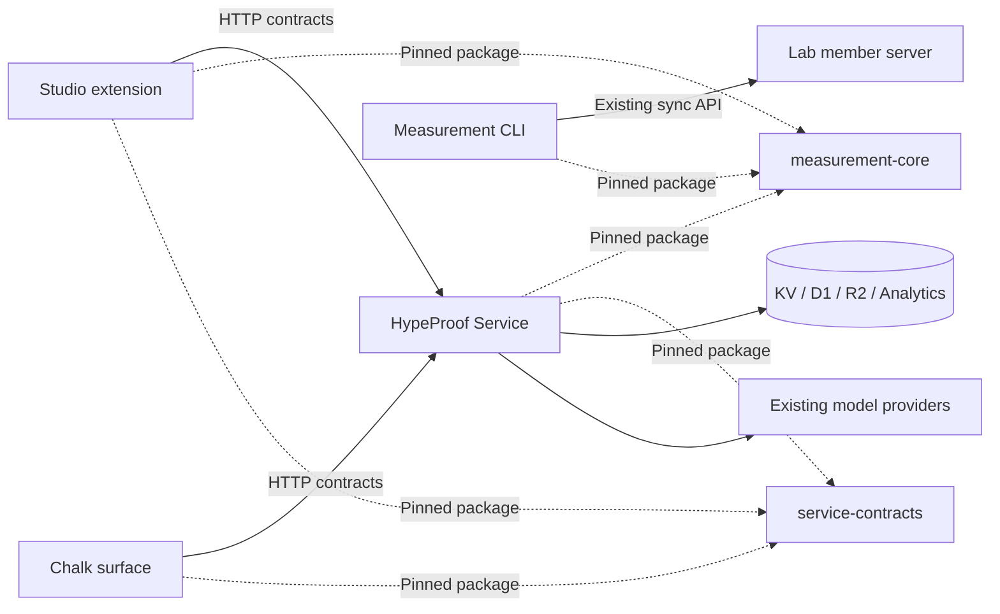

# Extract Worker into an independent HypeProof Service repository

상태: 구현 진행 중. measurement-core·service-contracts 0.1.0과 measurement CLI
0.3.5를 Service 레포에서 공개 배포했습니다. Studio 소비자 전환은 로컬 검증을
마쳤으며 PR·CI 확인 단계입니다. Worker 런타임과 운영 배포 주체는 아직 Studio에 있습니다.
Date: 2026-10-10.
Baseline inspected: Studio commit `2a21b44468806a66862d4ceb5389addede9eef11`.
Selected destination: `hypeproof/hypeproof-service` (public repository and public packages, confirmed 2026-10-10).
Scope: reduce source, storage, build, test and operational coupling while moving
the existing Service out of the Studio repository.

## 1. Outcome and product intent

Studio and Chalk must build without a checkout of Service source. Service and
the measurement CLI must build, test and release from the Service checkout
without Studio, a VSCodium submodule or sibling repositories. An installed CLI
must run without either repository checkout. Their connections become
versioned packages and HTTP contracts rather than relative filesystem paths.

Ownership decision, 2026-10-10: move both `packages/measurement-core` and
`packages/measurement` into `hypeproof-service`. Keep Studio and Chalk in
`hypeproof-studio`. This extraction uses two repositories. The measurement CLI
still runs on the user's computer and still sends records to Lab. Repository
ownership does not change its execution location or sync destination.

The user-visible outcome is continued access to the same learner work, classroom
operations and evidence while each product can ship independently. This supports
[Product Intent](docs/PRODUCT-INTENT.md): useful work first, visible human
judgment, evidence over claims and minimum necessary intervention.

Placement follows [Vessel and Modules](docs/plan/vessel-and-modules.md):

- App: local IDE, filesystem, browser and host integration.
- Service: authentication, authorization, policy, storage, budgets and APIs.
- Surface: instructor presentation and interactions in Chalk.
- Module: versioned curriculum and rubric data, with existing validated
  distribution and compiled fallback semantics preserved.

Repository placement does not redefine these layers. A pure library maintained
in the Service repository may be bundled into both App and Service releases.

Success is independent delivery with preserved behavior, not fewer directories.

## 2. Scope and constraints

Included:

- Extract shared, environment-independent logic into published packages.
- Move the measurement CLI source, build, tests and release ownership into Service.
- Remove imports across product source trees.
- Replace Chalk's direct storage access and shared token verifier with scoped
  Service APIs, preserving existing access distinctions.
- Move Service-owned runtime data, tests, tooling and operational documentation.
- Establish package releases, compatibility checks and independent Service CI.
- Preserve relevant Git history and document the old-to-new commit/path mapping.
- Transfer production deployment ownership after staged verification.

Outside this change:

- Moving Chalk into another repository; it stays in Studio initially.
- Renaming production domains, Worker resources or Cloudflare bindings.
- Copying or migrating production databases, KV namespaces or R2 buckets.
- Changing learner UX, capability definitions, provider routing or pricing.
- Changing consent, retention, deletion, operator access or logging policies.
- Creating another measurement store, scorer or authentication implementation.
- Replacing existing curriculum/module distribution with a new framework.
- Rebuilding the full Studio shell merely to validate documentation.

Preserve existing immutable migration numbers and content. Reuse applied schema;
do not apply the initial schema again to production during repository extraction.
The repository move must not invalidate existing tokens, sessions, pins or links.

## 3. Observed dependencies

This is a targeted architecture inspection, not a claim that all repository
files, historical revisions or open PRs have been audited. Refresh this inventory
at execution start because the background full-repository reading and concurrent
development may identify additional dependencies.

| Dependency | Observed evidence | Required disposition |
|---|---|---|
| Studio calls Service over HTTP | `products.yaml`; `extensions/hypeproof-chat/src/proxyClient.ts`; Service route mounts | Preserve public paths, streaming, errors and old-client behavior |
| Studio imports measurement core directly | `localReviewService.ts`, `localTranscript.ts`, `nativeObservationContract.ts`, `verifyRunner.ts` | Consume a versioned measurement-core package |
| Studio imports curriculum internals | `publishSet.ts` imports `venture.ts` and `publish-scan.ts` | Extract only the shared pure contracts/validation into public package exports |
| Chalk imports Service code | `chalk/src/shared.ts`: tokens, instructor-auth, kv, liveness, analytics and profiles | Replace with authorized API calls and contract imports |
| Chalk reads the same storage | `chalk/wrangler.toml`; `chalk/src/routes/{state,board,logs-admin}.ts` | Service owns storage access; Chalk receives scoped results |
| Chalk build installs Worker dependencies | `.github/workflows/deploy-chalk.yml` | Remove after source imports and in-process drift tests are replaced |
| Worker imports runtime data from docs | `worker/src/lib/native-assessment.ts` imports two rubric JSON files | Move canonical runtime data into Service; document provenance |
| Measurement CLI builds Worker core directly | `packages/measurement/build.mjs` | Move CLI and core into Service; build through declared package exports |
| Measurement CLI imports Studio adapters | `packages/measurement/src/adapters.ts` | Move host-neutral adapters to the Service-owned CLI package, preserving a single implementation |
| Worker tests inspect Studio and docs | `measurement-core.test.mjs`, `cr-recon.test.mjs`, `cr-traceability.test.mjs`, `sx-traceability.test.mjs` | Assign tests by ownership; preserve cross-product contract and traceability coverage |
| Root scripts/workflows manage Service | `scripts/dev-stack.sh`, `scripts/deploy-worker.sh`, `.github/workflows/deploy-worker.yml` | Move Service operations; retain explicit client-side dev orchestration |
| Registry and ledgers reference local Worker paths | `products.yaml`, `config/requirement-work.json`, `config/traceability.json` | Define external-reference support before deleting local paths |

`dependencies.yaml` is a toolchain manifest, not the repository dependency graph.
Do not use it as proof that product coupling has been removed.

The measurement CLI's default sync server is Lab (`https://hypeproof-ai.xyz`),
not this Worker. Its source dependency on Worker does not imply an API migration
to Service. Preserve its existing sync endpoint and receipt semantics.

## 4. Target architecture



Solid edges represent network or storage access. Dashed edges represent package
dependencies bundled into the consuming release. Chalk no longer accesses
Service storage or holds the Service signing secret.

### 4.1 Proposed destination tree

```text
hypeproof-service/
├── AGENTS.md
├── README.md
├── package.json                  # workspace and independent validation commands
├── package-lock.json
├── src/                          # existing Service runtime, policy and routes
├── migrations/                   # unchanged applied SQL migrations
├── data/
│   └── rubrics/                  # candidate and legacy compiled fallback data
├── test/                         # Service unit/API/storage regression tests
├── scripts/                      # Service-owned publish, migration and deploy tools
├── packages/
│   ├── measurement-core/         # pure measurement logic and portable contracts
│   ├── measurement/              # local CLI, adapters, build and tests
│   └── service-contracts/        # public API shapes and shared pure validation
├── docs/
│   ├── contracts/
│   ├── operations/
│   ├── testing/
│   └── migration/                # extraction manifest and provenance
├── .github/workflows/
├── wrangler.toml
└── wrangler.staging.toml
```

This is a proposed layout. Execute source moves only after the inventory and
package export boundaries are reviewed. All three packages are maintained in
the Service repository. Studio consumes released artifacts. No third repository
is required. The CLI is a separately installed local program, not a Worker route
or server-side background task.

### 4.2 Package boundaries

| Package | Public contents | Excluded contents |
|---|---|---|
| `@hypeproof/measurement-core` | Existing portable observation/evidence/interpretation/verification implementation, model definitions and local record contracts | Cloudflare bindings, VS Code APIs, credentials, filesystem adapters and HTTP clients |
| `@hypeproof/measurement` | Local CLI, host-record discovery, transcript adapters, local storage, preprocessing, outbox, Lab sync and receipt handling | Worker bindings, VS Code APIs, server authorization and production database access |
| `@hypeproof/service-contracts` | Public request/response types, stable error codes, shared curriculum document validation and publish scan needed by both hosts | Token signing, authorization decisions, SQL, provider adapters, budget admission and private route helpers |

Use explicit subpath exports to keep consumers from importing package internals.
For example, `measurement-core/verification` and `service-contracts/curriculum`
may be public; exact export names are decided from the inventory. Inspect
`venture.ts` before exporting it: server-private orchestration stays internal.

Distinguish types from execution: TypeScript interfaces do not validate incoming
JSON. Keep existing runtime validation and re-run authoritative checks on the
Service even when the App performs an earlier check. Do not relax signature or
authorization checks because a client-side scan passed.

Ship ESM JavaScript and declaration files suitable for current consumers. Validate
Node, Cloudflare and the extension/webview bundles separately. Do not add Node
built-ins to the portable core. Preserve existing `.ts` test entry behavior until
package-consumer tests replace it deliberately.

### 4.3 Package delivery and compatibility

- Selected distribution: public GitHub Release assets in `hypeproof/hypeproof-service`.
  Pin versioned tgz URLs and lockfile integrity; never overwrite released assets.
- Use immutable versions, exact dependency versions and committed lockfiles.
  Ban production `file:`, sibling paths, Git branch dependencies and deep imports.
- During initial local development, test immutable packed artifacts rather than
  requiring a sibling checkout. `npm pack` is a validation mechanism, not the
  final distribution channel.
- Publish packages before consumer PRs require them. A published version is not
  overwritten to repair it; publish a new version.
- Release records bind package version, source commit, artifact digest and actual
  validation. Registry credentials are CI secrets, not repository content.
- Keep API protocol versions separate from package and Service release versions.
  An installed App retains its bundled package version after a server deployment.
- Make API changes additive while old installed clients remain supported. Record
  the supported client/protocol matrix; a breaking change requires an explicit
  migration and retirement decision, not a major package version alone.

## 5. Service and Chalk responsibilities

### 5.1 Service owns

Authentication and issuer scope enforcement; token signatures; participant gate
state; raw storage access; usage accounting; model/provider policy; deletion and
retention; authorized log retrieval; curriculum persistence and authoritative
validation. There is one implementation and one owner for each policy.

### 5.2 Chalk owns

Instructor pages, interactions, presentation and surface-specific pure helpers.
The board's calibrated display/derived-state behavior can remain in Chalk if
Service returns the required normalized inputs and data-quality signals. Do not
create a second failure predicate, query the SQL schema from Chalk, or move
thresholds into the App as part of this change.

### 5.3 Read API migration

Preserve existing Chalk-facing paths where practical. Add distinct Service paths
only where needed to avoid collisions with current routes. Endpoint names are
not decided here; the API slice must record the mapping before implementation.

| Existing Chalk capability | Service response obligation | Authorization boundary |
|---|---|---|
| Cohort state | Active session, pause state, roster and existing profile display fields | Existing issuer cohort scope |
| Board inputs | Seat set, bounded usage aggregates, heartbeat/artifact metadata, time window and unknown/degraded signals | Existing issuer scope; no participant prose |
| Logs listing | Bounded metadata, filters, pagination and roster scope | Existing issuer/operator distinction |
| Raw log retrieval | Authorized file bytes and existing failure classifications | Operator only, never ordinary instructor |
| Instructor mutations | Existing idempotency, revision and per-target results | Existing Service enforcement |

Avoid an extra HTTP request per seat: use a bounded cohort read corresponding to
the existing board operation. Preserve `seat_prefix`, day/session filters and
unknown-versus-zero semantics. Read authorization applies before data leaves the
Service; a hidden UI element is not a permission check.

For raw-log retrieval, inventory how operator identity is established today.
Chalk must not forward arbitrary Access identity headers as trusted identity.
Choose a verifiable audience-bound identity assertion or let the browser call an
appropriately protected Service endpoint, then test its scope and expiry. Do not
replace operator-only access with an instructor bearer token or put a shared
operator secret in browser code. Access-policy changes require explicit approval.

Keep authentication errors distinct from transport failures. A failed read must
show unavailable/unknown; it must not render an empty class as healthy. Preserve
timeouts, cancellation, no-store headers and request-ID correlation across hops.
Measure board response latency before and after migration and agree an acceptance
budget from the baseline before enabling the new path.

After Chalk uses API reads, remove its Service signing secret and KV/D1/R2
bindings from configuration. Remove remote secret bindings only through the
approved operational procedure after rollback compatibility is resolved.

## 6. Ownership of data, documentation and tests

### 6.1 Runtime data

Move both rubric JSON files currently imported from `docs/curriculum/studio-trial`
into Service-owned `data/rubrics`. Preserve their contents and provenance in the
first move. Continue existing module pin/version/fallback behavior; this step
does not activate a rubric or publish a curriculum module.

Classify every other fixture, curriculum file and imported Markdown/HTML/YAML by
consumer. Existing Worker-local prompts, skills, skeletons and cohort-harness
rules move with their consumer. A runtime file must not depend on documentation
being present in an unrelated checkout. A truly shared artifact needs one owner
and an immutable versioned export, not two manually edited copies.

### 6.2 Requirements and registries

Keep philosophy and product intent at their canonical owners. Do not duplicate
definitions into Service docs. Service operation/API docs move; cross-product
requirements may remain in Studio with repository-qualified links and pinned
verification inputs where needed.

Before extraction, explicitly decide how existing registry tools resolve remote
products, contracts and drift locks. `products.yaml` currently registers Worker
with local paths; simply deleting `worker/` breaks that contract. Extend or
reconcile the registry using its supported schema and canonical Harness owner,
then validate both repositories. Do not invent an unchecked remote field.

Update requirement-work and traceability references without treating a path move
as requirement completion. Preserve requirement IDs and link the execution work
to existing criteria. Historical evidence retains original paths/commits with an
extraction mapping rather than being rewritten to suggest it ran on the new tree.

### 6.3 Test placement

| Test responsibility | Owner after extraction |
|---|---|
| Portable pure logic and package exports | Owning shared package |
| HTTP authorization, provider policy, budgets, storage and migrations | Service |
| React rendering, VS Code behavior, local files and Electron lifecycle | Studio |
| Chalk interactions, board derivation and Service-unavailable presentation | Chalk |
| CLI discovery, preprocessing, outbox and Lab receipts | `packages/measurement` in the Service repository |
| Public contract compatibility across products | Versioned consumer fixtures plus dedicated integration lane |
| Product-wide intent/requirement traceability | Canonical product/Harness checks with explicit repository references |

Replace the current same-function-object checks across relative import paths
with package-consumer behavior and artifact/version checks. Retain the guarantees
they protected. Source-text assertions that refer to App files must either move
to App tests or become contract tests; do not drop them merely to obtain green CI.

Service PR validation must not require fetching an unpinned Studio main branch.
Cross-product integration uses declared versions/commits in a compatibility
manifest. Failure to obtain a required artifact is BLOCKED, not a skipped pass.

## 7. Execution phases and gates

The phases below describe the original execution plan. Current progress is recorded
in `service-extraction-progress.json` and the [Service extraction Kanban](https://github.com/orgs/hypeproof/projects/1).
Portable packages 0.1.0 have been publicly released; consumer package changes pass
local regression checks. Runtime, Chalk, registry and deployment transitions remain
open in Backlog. Gates are sequential; parallel work is
appropriate only for independent inventories, fixtures and documentation after
their interfaces are agreed. One coordinator owns GitHub discovery and claims.

### Phase 0 — Reconcile current work and establish a baseline

Tasks:

1. Run `python3 scripts/next-work.py` and read the current requirement ledger.
   Inspect open work affecting the shared core, Chalk and deployment before
   claiming implementation. Use the canonical Harness discovery rather than
   inferring that a completed historical plan exhausts work.
2. Record clean checkout SHA, relevant open-PR heads, toolchain versions and the
   current supported installed-App versions. Reconcile changes since this plan.
3. Inventory static imports, re-exports, dynamic imports, filesystem reads,
   test fixtures, shell paths, CI paths and runtime URLs. Include Lab consumers
   of exported core behavior, not just this repository's TypeScript imports.
4. Produce a file disposition manifest: move, extract, retain, replace or archive;
   give every shared artifact and test a single owner.
5. Record API fixtures, auth refusal cases, streaming traces and storage query
   behavior using synthetic/local environments. Record Chalk latency baseline.
6. Confirm destination repository name, visibility, package distribution and
   operational owner. Identify any account/access changes requiring approval.

Deliverables: dependency inventory, disposition manifest, compatibility matrix,
baseline evidence, linked execution issues and approved ownership decisions.

Gate: every known dependency has a destination and a verification method; work
ownership is reconciled. Missing discovery inputs remain explicitly unknown.

### Phase 1 — Package portable logic in the existing repository

Tasks:

1. Move the existing measurement core and its pure tests behind a package boundary.
2. Extract only shared pure curriculum/API contracts into service-contracts.
3. Keep temporary old-path re-exports where needed for incremental PRs. Give each
   shim a consumer-removal checklist and remove it before physical extraction.
4. Produce package builds, declarations, exports and packed artifacts.
5. Verify each package from an isolated consumer directory using the packed
   artifact. That directory must not have source symlinks into Studio.
6. Publish the first immutable versions after the release/access decisions.

Controls: valid candidate/legacy evidence remains accepted; malformed evidence,
unsupported independence and invalid publish artifacts remain rejected. Existing
capability IDs, provenance and storage formats retain their semantics.

Gate: portable packages build and test independently; no Worker or App runtime
dependencies enter the portable core; public exports are explicit and documented.

Rollback: revert consumer/package-boundary commits while no production schema or
runtime change has occurred. Keep published artifacts immutable.

### Phase 2 — Switch Studio and measurement consumers

Tasks:

1. Replace extension imports with exact package dependencies, distinguishing
   type-only imports from runtime imports and preserving bundling behavior.
2. Change measurement's direct core build entry to the package export.
3. Prepare both measurement packages for extraction into Service. Move the CLI's
   source, build, tests, fixtures, README and release tooling together. Move
   host-neutral transcript/discovery/storage adapters to measurement ownership
   and let Studio consume the same implementation where required. Importing an
   adapter must not start CLI collection or sync. If this creates
   a dependency cycle, extract that adapter boundary as a separate package only
   after documenting the concrete cycle; do not add it preemptively.
4. Preserve CLI-to-Lab sync routes, redaction, deletion suppression and receipts.
5. Remove tests and build scripts that require sibling Service source; keep
   independent local fake APIs and exact contract fixtures.
6. Update installers/developer tooling to obtain packages without a Service checkout.

Gate: extension host/webview checks pass without Service source. The measurement
package builds without Studio or the old `worker/` tree, using declared core
package exports. Its installed tarball passes relevant checks without either
repository checkout. No relative import, build path or source-map dependency
requires Studio or the old Worker tree. Relevant real-App validation is
recorded separately from unit/browser checks.

Rollback: return consumers to their prior package/source versions; published
packages remain available. Do not delete learner files or change CLI sync state.

### Phase 3 — Replace Chalk's source and storage coupling

Tasks:

1. Implement additive, scoped Service read routes and contract fixtures.
2. Run old direct reads and new API reads against the same synthetic data, compare
   results and classify every difference before switching the consumer.
3. Switch Chalk reads, retaining its presentation and calibrated pure helpers.
4. Migrate operator log retrieval through the approved identity boundary.
5. Replace in-process Service boot/import tests with authorization contract and
   network interaction checks against declared Service artifacts.
6. Remove Service imports, Worker dependency installation, signing-secret usage
   and direct storage bindings after the rollback window is defined.

Controls: wrong cohort/scope, revoked/expired token, ordinary issuer requesting raw
logs, forged forwarded identity, invalid filters and Service outage. Verify no raw
participant prose appears in board/listing responses and no per-seat request storm.

Gate: Chalk builds/tests from its own dependencies; the new read path preserves
outputs, access boundaries, degraded signals and agreed latency. Chalk has zero
Service source imports and zero direct Service storage calls.

Rollback: before remote bindings are removed, switch to the previous compatible
Chalk artifact. After removal, prefer a prior API-based artifact; restoring old
bindings/secrets becomes an explicit operational recovery, not an automatic step.

### Phase 4 — Make Service self-contained before moving it

Tasks:

1. Move runtime rubric data and all Service-owned inputs into the extraction set.
2. Assign Worker tests that currently read Studio docs/config/App source to their
   final owners, preserving assertions and requirement traceability.
3. Move Service-owned deploy, smoke, module-publish and migration tools; replace
   assumptions about repository-root names and working directories.
4. Keep Studio's optional local-stack orchestration configurable by explicit
   Service checkout or prebuilt Service artifact. Require no sibling checkout for
   ordinary Studio unit/build validation. Do not silently fall back to production.
5. Reconcile registry/ledger external-reference support and package admission.
6. Validate a temporary extraction copy outside Studio, with no parent paths,
   symlinks or runtime reads from the original checkout.

Gate: independent copy passes Service/package checks, resolves every runtime
asset, starts locally and bundles without Studio. Record any environment-bound
checks as NOT RUN/BLOCKED rather than marking this phase complete.

### Phase 5 — Create and validate the independent repository

Tasks:

1. Use a disposable clone for history filtering; never rewrite Studio history.
   Select extraction tooling after the disposition manifest is complete.
2. Include the worker history, the existing `packages/measurement` history and
   the newly extracted measurement-core, contracts, data and tooling histories.
   A worker-only subtree split is insufficient because inputs live elsewhere.
3. Normalize destination paths and publish an original-to-extracted SHA/path map.
   Preserve authorship; filtered SHAs and signatures cannot be assumed identical.
4. Exclude secrets, local env files, build artifacts and unrelated product assets.
   Audit the selected history for accidentally tracked secrets before publishing.
5. Bring over Service-scoped instructions, requirements links and verification rules.
6. Establish independent package and Service CI with production deploys initially
   disabled. Test from a fresh clone, not only the extraction working directory.
7. Add Studio consumer integration using exact released Service/package versions.

Gate: fresh Service clone and fresh Studio clone pass their independent required
checks. Service CI does not need Studio source; Studio CI does not need Service
source except the explicitly separate, pinned integration lane.

Rollback: retain the Studio source and production workflow until the deployment
handover gate. A new repository must not start deploying just because it exists.

### Phase 6 — Transfer deployment ownership

This is an operational handover, separate from source extraction.

Tasks:

1. Reconcile exact deployed version, additive migration state, cron configuration,
   domains, secret names, environment variables and current bindings. Record names
   and versions without recording secret values or participant content.
2. Transfer the established workshop freeze, smoke, rollback and release checks
   from the old workflow. Keep `w*` Service tags and independent App/Chalk trains.
3. Verify on staging with synthetic accounts; do not point isolated test commands
   at production resources. Prove cron/retention/backup dispatch is unchanged.
4. Pause the old production deploy trigger and block manual deployment there.
   Reconcile queued/running jobs and developer deployment scripts before enabling
   the new workflow. GitHub concurrency groups do not serialize different repos.
5. Enable the new deployment owner using the existing Worker name, domains,
   storage and signing secret; no new resource provisioning or secret rotation.
6. Deploy the validated artifact in the approved window, run bounded authorized
   smoke checks and record actual version/contract outcomes.
7. Keep previous artifact/package versions and the previous deploy procedure
   available through the agreed rollback window.

Gate: one active deployment owner; unchanged resources and token compatibility;
required production smoke evidence; tested rollback procedure; no duplicated cron
worker or unexpected storage migration.

Rollback: redeploy the previous validated Service artifact. No database restore is
part of this source-only handover. Re-enabling the old deploy owner requires first
disabling the new one and reconciling running jobs.

### Phase 7 — Remove the old implementation and close the migration

Tasks:

1. Remove `worker/`, the old `packages/measurement` and
   `packages/measurement-core` source trees, and temporary shims only after their
   consumer, package-release and deployment gates. Retain installed package
   dependencies needed by Studio.
2. Remove old deploy triggers and misleading setup instructions. Preserve a concise
   Service discovery link and the extraction provenance for historical references.
3. Update README, AGENTS/CLAUDE indexes, developer launcher, registry, requirement
   ledger and traceability tools to the accepted repository boundaries.
4. Repeat absent-source and fresh-clone checks at the final heads; publish the
   tested compatibility manifest and ownership/runbook links.
5. Close migration work only when required human/environment checks have evidence.
   Remaining checks stay on linked work items; local synthetic passes do not close
   real-App or production acceptance.

Gate: final completion checklist below is satisfied with evidence, and no active
consumer/build/deploy dependency points at the removed tree.

## 8. Suggested PR packets and dependency order

These are implementation packets, not promises that each fits a single session.
Split packets further where review or validation requires it.

| Packet | Change | Depends on | Review evidence |
|---|---|---|---|
| E0 | Inventory, ownership decisions and compatibility baseline | None | Complete disposition manifest; current work reconciled |
| E1 | measurement-core package boundary and tests | E0 | Isolated tarball consumer; preserved positive/negative controls |
| E2 | Public API/curriculum contracts package | E0 | Export audit; pure runtime validation; no private auth/storage exports |
| E3 | Studio switches to packages | E1, E2 | Host/webview checks with Worker source absent |
| E4 | Prepare measurement for Service ownership; remove cross-source builds/adapters | E1 | CLI/core extraction manifest; packed CLI checks; unchanged Lab transport and receipts |
| E5 | Additive Service read APIs for Chalk | E0, E2 | Auth controls and old/new synthetic output comparison |
| E6 | Chalk API consumer and removal of direct dependencies | E5 | Storage/import absence; browser behavior; outage and operator controls |
| E7 | Service-owned assets/tests/tools and registry reconciliation | E0; coordinate with E1–E6 | Standalone extraction-copy checks and traceability |
| E8 | History extraction and independent CI | E3, E4, E6, E7 | Fresh clones; provenance map; deploy disabled |
| E9 | Deployment-owner handover | E8 | Staging, freeze, smoke and rollback evidence |
| E10 | Studio cleanup and final compatibility run | E9 | No residual dependencies; final acceptance report |

Within Studio, use focused branches and PRs under the existing dev guide and
hype-pr preparation contract. New Service PR tooling must be configured through
the canonical Harness rather than assuming it already recognizes the new repo.
No packet grants merge or production authority.

## 9. Verification matrix

| Area | Positive control | Negative control | Evidence required |
|---|---|---|---|
| Package isolation | Packed package installs/builds outside source tree | Missing private source/deep import fails explicitly | Artifact digest, exports and isolated run |
| Measurement semantics | Existing valid candidate/legacy fixtures retain interpretation | Unsupported independence, bad references and fabricated claims rejected | Existing controls moved, not reimplemented |
| API compatibility | Recorded supported clients preserve profile/chat/classroom behavior | Malformed fields and unsupported capability negotiation retain named refusals | Versioned client/protocol matrix |
| Streaming | Ordering, usage and cancellation preserved | Midstream failure never reported as complete success | Local protocol traces; no participant bodies |
| Chalk permissions | Authorized issuer reads scoped metadata | Other cohort, revoked token and issuer raw-log request rejected | API and browser tests |
| Operator retrieval | Valid scoped operator reads authorized bytes | Forged identity and expired/wrong-audience assertion refused | Chosen auth-boundary tests |
| Chalk outage | Normal API data renders expected seats | Timeout/outage shows unknown, never empty healthy class | Browser evidence and latency comparison |
| Storage/accounting | Existing schema and cost records retain behavior | Unauthorized writes, duplicate billing and unintended migrations detected | Existing storage and concurrency suites |
| Module/rubric data | Known pin and compiled fallback resolve correctly | Invalid/missing module retains existing safe failure behavior | Artifact manifest and module tests |
| Measurement CLI | Redacted deltas and receipts reach the existing Lab mock/API contract | Offline/conflict/deletion retains existing recovery behavior | Packed CLI tests |
| Deployment isolation | Service releases without App/Chalk rebuild | Old repo deploy is blocked; duplicate scheduler absent | Workflow review and staging execution |
| History/ownership | Selected files retain provenance mapping | Missing asset, unowned fixture and secret inclusion detected | Extraction manifest and history audit |

Run the existing relevant suites before and after each behavioral change. Reuse
`worker` tests/typecheck, core controls, Chalk tests/typecheck, extension host and
webview checks, measurement tests and appropriate E2E/D1 suites as a baseline;
relocate command paths as ownership changes. No full shell build is authorized by
this plan. Choose installed-App checks for actual host lifecycle behavior.

Every run record includes commit, artifact/package versions, command, environment,
result and evidence path. A test definition is not execution. Retain explicit
PASS/FAIL/NOT RUN/BLOCKED and distinguish synthetic, real-App and production runs.

## 10. Risks and recovery

| Risk | Prevention | Recovery |
|---|---|---|
| Old installed clients break after Service release | Keep additive API and legacy fixtures | Redeploy previous compatible artifact |
| Packages become another tightly coupled source tree | Explicit exports, immutable versions, isolated consumer checks | Pin previous version and revise the public boundary |
| Chalk loses authorization or exposes raw records | Service-owned checks and operator negative controls | Revert API-based consumer/server versions; restrict affected route |
| HTTP migration slows board polling | Bounded cohort reads; measured baseline and deadline | Revert rollout before deleting fallback bindings |
| Source-path tests disappear silently | Per-test ownership/disposition manifest | Restore coverage before gate completion |
| Docs/config still require deleted paths | Registry/Harness reconciliation before cleanup | Retain old tree until tooling understands the new boundary |
| Two repos deploy over each other | Sequential handover and queued-job reconciliation | Disable both triggers, establish one owner, redeploy known artifact |
| Extraction omits imported data or tooling | File manifest plus isolated fresh-clone execution | Add missing inputs and repeat extraction checks |
| Filtered history includes secrets | Audit disposable extraction before publication | Stop publication; follow explicit incident/rotation procedure if exposure occurred |
| Registry access prevents consumer builds | Decide access and test clean member/CI installs | Retain prior consumer artifact; resolve registry access before rollout |

Do not use rollback as permission to rotate secrets, restore production databases
or change retention. Those are separate actions with their own authorization.

## 11. Decisions required before dependent implementation

| Decision | Proposed default | Needed by |
|---|---|---|
| Repository identity and visibility | `hypeproof-service`; visibility explicitly selected | E0/E8 |
| Package registry/access | Immutable registry releases; exact versions | E1–E4 |
| Shared package ownership | Service repo maintains measurement-core, measurement and public contracts; confirmed 2026-10-10 | E1/E2/E4 |
| Measurement adapter ownership | Service-owned measurement package owns host-neutral local adapters | E4 |
| Chalk board computation boundary | Service returns normalized inputs; Chalk keeps calibrated presentation helpers | E5/E6 |
| Operator authentication transport | Verifiable existing identity boundary; never trust arbitrary forwarded headers | E5/E6 |
| Supported installed clients | Inventory actual supported release/protocol versions | E0/E9 |
| Cross-repo registry/traceability support | Extend canonical tooling explicitly before removing local paths | E7/E10 |
| Package release and rollback window | Agree from current client/service compatibility and workshop schedule | E8/E9 |
| Production deploy ownership/access | One active CI owner; preserve existing Cloudflare resources | E9 |

Documentation, local extraction experiments and reversible code work can proceed
within authorization. Account/billing/access-policy changes, production identity
changes, participant privacy changes and destructive operations follow
[Autonomy Mandate](docs/AUTONOMY-MANDATE.md). Prepare concrete staging evidence and
an executable handover/rollback procedure before seeking required operational
approval. This plan does not itself authorize production changes.

## 12. Final completion checklist

- [ ] Dependency and file/test disposition manifests reconciled at final heads.
- [ ] Service builds/tests from a fresh independent checkout.
- [ ] Studio builds without Service source present.
- [ ] Service owns the measurement and measurement-core source, build, tests and releases.
- [ ] Measurement builds from Service without Studio source and runs from its installed artifact without either checkout.
- [ ] Measurement still runs locally and preserves its existing Lab sync destination.
- [ ] Chalk builds without Worker dependencies, signing secret or storage bindings.
- [ ] No product reaches another product's private source by relative/deep import.
- [ ] Public packages have immutable artifacts, explicit exports and pinned consumers.
- [ ] Existing core behavior and legacy evidence compatibility are verified.
- [ ] Supported installed clients retain HTTP/streaming behavior.
- [ ] Instructor metadata and operator raw-log permissions retain their boundaries.
- [ ] Existing migration history, storage resources and token continuity are preserved.
- [ ] Runtime assets, tests and operational tools have explicit owners.
- [ ] Registry/requirements/traceability checks resolve the new repository references.
- [ ] Relevant Git provenance is recorded and selected history is audited.
- [ ] Exactly one production deploy owner and one existing scheduler remain.
- [ ] Staging, required real-App and authorized production checks have run evidence.
- [ ] Rollback artifacts and a tested ownership handover procedure are available.
- [ ] Temporary shims and old active deploy paths are removed after the rollback gate.
- [ ] Remaining human/environment acceptance is tracked and not reported as complete.

## 13. Planning-session evidence and limitations

Performed for this document: targeted source/config/test inspection; read the
repository rules and requirement execution contract; attempted work discovery.
`python3 scripts/next-work.py` exited with the canonical Harness unavailable, so
current GitHub work availability/ownership is unknown and must be reconciled at
Phase 0. This does not block writing the user-requested plan.

No implementation test, extraction experiment, package publication, GitHub
repository creation, database operation or deployment was performed for this
plan. All execution gates remain planned. The full-repository background reading
is a separate ongoing task and may refine the dependency inventory.
